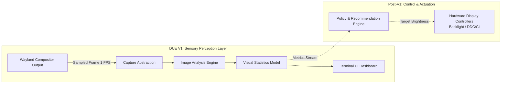
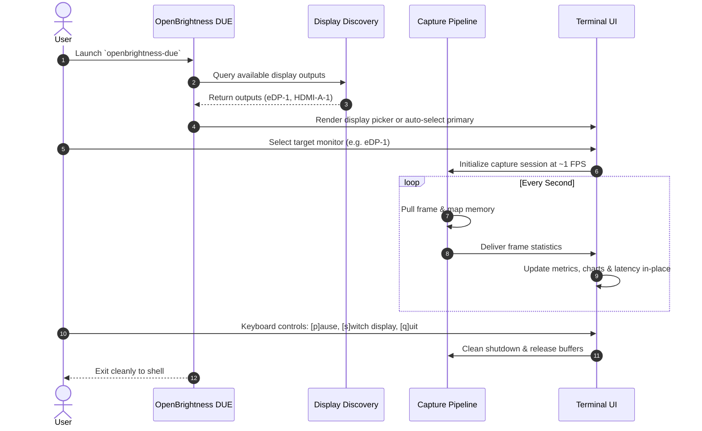
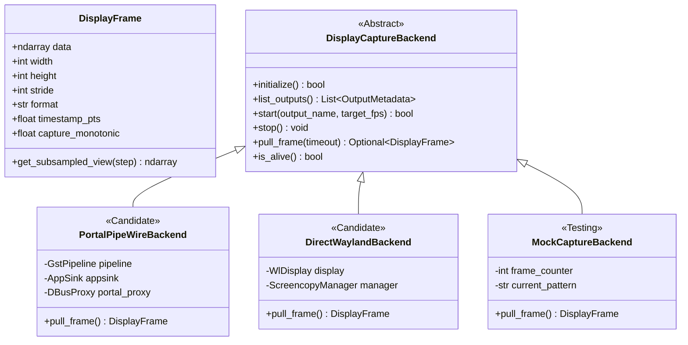
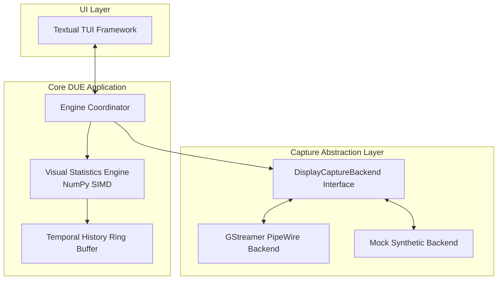
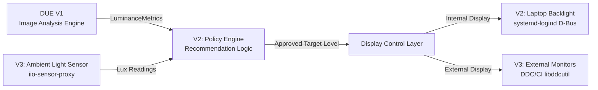

# OpenBrightness — Display Understanding Engine (DUE) V1

**Document Type:** Idea, Concept & Preliminary Architectural Design  
**Status:** Working Draft (Pre-Implementation)  
**Target Environment:** Fedora Linux (x86_64), Niri Wayland Compositor  
**Author:** OpenBrightness Team  
**Date:** October 2026  

---

## 1. Project Context & Long-Term Vision

### 1.1 The OpenBrightness Vision
OpenBrightness is an open-source, Linux-first display management project. On modern desktop platforms, display control is often fragmented, proprietary, or tied to closed desktop environments. The long-term vision of OpenBrightness is to establish a modular, vendor-neutral foundation for Linux display management that can support:
- Content-aware display optimization.
- Ambient-light-responsive adaptive brightness.
- Hardware-level display adjustments (internal laptop panels and external desktop monitors).
- Display profiling, color management coordination, and visual comfort automation.

### 1.2 The Role of the Display Understanding Engine (DUE)
Before a system can make intelligent display adjustments, it must perceive and understand what is being displayed. The **Display Understanding Engine (DUE)** is the sensory perception layer of OpenBrightness. 

Its role is to analyze the real-time visual output rendered on a selected monitor and calculate objective, reproducible statistical metrics (such as brightness distribution, contrast, dark-to-bright pixel ratios, and temporal change rates). 

In future versions, these metrics will feed into a recommendation and control layer. In **V1**, DUE operates in an exclusively read-only, informational mode.



### 1.3 Target Environment & Technology Selection
- **Primary OS:** Fedora Linux (Workstation).
- **Primary Compositor:** Niri (a modern, scrollable-tiling Wayland compositor).
- **Target Hardware:** Laptops with internal eDP panels and external HDMI/DisplayPort monitors.
- **Language Choice:** **Python 3.12+** has been selected for V1. While systems programming languages (Rust, C) may be considered for future background daemons, Python provides the ideal ecosystem for rapid experimentation in numerical image processing, statistical modeling, and terminal user interfaces, turning DUE into an accessible testbed for computer vision exploration.

---

## 2. V1 Vision & Core Objectives

OpenBrightness DUE V1 is envisioned as a **local, terminal-based monitoring tool**. It connects to a user-selected monitor, captures rendered frames at a steady, fixed sampling rate (~1 frame per second), calculates visual statistics in memory, and presents those metrics through a clean, continuously updating Terminal User Interface (TUI).

### Core Principles for V1:
1. **Perception Without Semantic Interpretation:** DUE V1 computes purely mathematical and statistical properties of the pixel array (luminance histograms, percentiles, contrast metrics). It does *not* attempt computer-vision object detection, OCR, text extraction, or semantic scene understanding.
2. **Diverse Content Handling:** The engine must accurately characterize diverse real-world workloads:
   - *Dark mode interfaces:* Code editors, terminal emulators, dark IDEs.
   - *Bright documents:* Web browsers with light backgrounds, spreadsheets, reading applications.
   - *Mixed-luminance media:* Photographs, video streams, graphic designs containing strong highlights and deep shadows simultaneously.
   - *Static vs. dynamic scenes:* Distinguishing static reading sessions from active video playback or rapid scrolling.
3. **Zero Storage & Log Pollution:** The application must run in-place in memory. It must never save screenshot files to the disk by default, nor flood the terminal with an unreadable stream of scrolling log output.

---

## 3. User Experience & Interface Concept

### 3.1 Interaction Flow
The user experience is designed to be self-contained, interactive, and terminal-native:



### 3.2 TUI Concept & Dashboard Elements
The TUI should remain **compact, functional, and visually clean**, designed to fit comfortably in a split terminal pane alongside a code editor or web browser without behaving like a bloated, flashy dashboard.

```
┌─ OpenBrightness DUE ── [LIVE: eDP-1 (1920x1200)] ───────────────────────────────┐
│ Status: Active (1.0 FPS)    Capture: 1.2 ms    Analysis: 0.9 ms    Total: 2.1 ms  │
├──────────────────────────────────────────────────────────────────────────────────┤
│ LUMINANCE METRICS                                                                │
│   Mean Luminance:    142.4 / 255  (55.8%)    Dark Pixels (<20%):   14.2%         │
│   Median (P50):      138.0 / 255  (54.1%)    Bright Pixels (>80%): 22.8%         │
│   Percentile P10:     32.0 / 255  (12.5%)    RMS Contrast:         0.384         │
│   Percentile P90:    218.0 / 255  (85.5%)    Temporal Change:       2.1% (Low)   │
├──────────────────────────────────────────────────────────────────────────────────┤
│ DISTRIBUTION HISTOGRAM (64 Bins, 0-255)                                         │
│   0%   ................................................................  100%    │
│        ██                                                                        │
│        ████        ▄▄                                        ████                │
│        ██████▄   ▄████▄   ▄▄                               ▄██████▄              │
│        ████████▄████████▄████▄▄                          ▄██████████▄            │
│   0 ───┴──────────┴──────────┴──────────┴──────────┴──────────┴──────────┴── 255 │
├──────────────────────────────────────────────────────────────────────────────────┤
│ KEYBOARD CONTROLS: [P]ause/Resume   [S]witch Display   [R]eset Stats   [Q]uit    │
└──────────────────────────────────────────────────────────────────────────────────┘
```

#### Proposed Interface Elements:
- **Header & Session Telemetry:** Active display name, physical resolution, current sampling rate, and end-to-end processing latency.
- **Luminance Summary:** Mean and median perceptual luminance, 10th and 90th percentiles.
- **Dynamic Range & Distribution:** Dark-pixel ratio ($Y < 20\%$) and bright-pixel ratio ($Y > 80\%$).
- **Contrast Metric:** Root-Mean-Square (RMS) contrast or Michelson contrast.
- **Temporal Stability:** Visual frame-to-frame difference indicating static vs. dynamic content.
- **Visual Histogram:** A compact horizontal ASCII/Unicode bar chart representing the 64-bin luminance distribution.
- **Status & Error Banner:** Warnings for capture pipeline drops, permission errors, or display disconnections.

---

## 4. Capture Architecture & Abstraction

To ensure modularity and future-proofing, the capture subsystem must be insulated behind an abstract interface. The image analysis engine must never interact directly with low-level Wayland protocol objects, D-Bus sockets, or GStreamer pipelines.



### 4.1 Capture Approaches Under Investigation
1. **XDG Desktop Portal ScreenCast + PipeWire:**
   - *Concept:* Standard Freedesktop D-Bus portal brokers user permission, opening a PipeWire stream consumed via GStreamer `pipewiresrc` and `appsink`.
   - *Strengths:* Universal compatibility across all modern Wayland compositors (GNOME, KDE, wlroots, Niri). Persistent session restore tokens avoid repeated prompts.
2. **Direct Compositor Wayland Protocols:**
   - *Concept:* Native Wayland protocols (`zwlr_screencopy_v1` or staging `ext-image-copy-capture-v1`).
   - *Strengths:* Direct shared-memory copy, zero D-Bus portal interaction, programmatically selectable by output handle.
   - *Limitations:* Not supported on GNOME or KDE; `ext-image-copy-capture` is not yet widely exposed in stable compositors.
3. **Direct Compositor D-Bus Interfaces:**
   - *Concept:* Compositor-specific D-Bus endpoints (e.g. Niri's `org.gnome.Mutter.ScreenCast`).
   - *Strengths:* Headless, dialog-free PipeWire stream creation on supported compositors.

### 4.2 The Mock Capture Backend (Crucial for V1 Development)
A dedicated `MockCaptureBackend` is an essential component of the V1 architecture. It will generate synthetic in-memory frames without requiring a running Wayland session, active PipeWire daemon, or physical display:
- Grayscale gradients ($0 \rightarrow 255$).
- Solid black, white, and mid-gray patterns.
- High-contrast checkerboards.
- Synthetic step wedges and noise patterns.
- Simulated video scenes with oscillating brightness.

This enables automated unit tests, headless CI execution, and rapid TUI styling in isolated terminal sessions.

---

## 5. Visual Statistics & Mathematical Modeling

DUE V1 focuses on **deterministic numerical image processing** using NumPy. It avoids machine learning models, neural networks, or heuristic approximations.

### 5.1 Color Space & Luminance Formulation
Captured frames are ingested in RGB (or BGRx) format. To accurately reflect human visual sensitivity to different wavelengths of light, DUE applies the **ITU-R BT.709** standard for relative perceptual luminance ($Y$):

$$Y = 0.2126 \cdot R + 0.7152 \cdot G + 0.0722 \cdot B$$

For high-performance SIMD execution in NumPy on integer arrays, an integer fixed-point approximation can be evaluated:

$$Y_{\text{int}} = (54 \cdot R + 183 \cdot G + 19 \cdot B) \gg 8$$

> [!IMPORTANT]
> **Relative Luminance vs. Physical Photometric Light:**  
> The luminance values calculated by DUE ($Y \in [0, 255]$ or $[0.0, 1.0]$) represent **relative pixel intensities** within the digital framebuffer. They do **not** represent physical luminous flux emitted by the monitor panel (measured in candelas per square meter or nits, $\text{cd/m}^2$). An OLED screen at 10% backlight and an IPS screen at 100% backlight displaying the same pure white pixel ($255$) have identical digital luminance but radically different physical nits.

---

### 5.2 Proposed Statistical Metrics

| Metric | Mathematical Definition | Range | Analytical Purpose |
| :--- | :--- | :--- | :--- |
| **Mean Luminance ($\bar{Y}$)** | $\frac{1}{N} \sum_{i=1}^N Y_i$ | $[0, 255]$ | Overall global lightness of the display content. |
| **Median Luminance ($P_{50}$)** | 50th percentile of $Y$ | $[0, 255]$ | Robust central tendency resistant to extreme highlight/shadow outliers. |
| **Dark-Pixel Ratio ($R_{\text{dark}}$)** | $\frac{1}{N} \sum_{i=1}^N [Y_i < T_{\text{dark}}]$ (default $T = 51$) | $[0.0, 1.0]$ | Identifies dark-mode interfaces, terminals, or night scenes. |
| **Bright-Pixel Ratio ($R_{\text{bright}}$)** | $\frac{1}{N} \sum_{i=1}^N [Y_i > T_{\text{bright}}]$ (default $T = 204$) | $[0.0, 1.0]$ | Identifies bright webpages, documents, or high-key imagery. |
| **Luminance Percentiles** | $P_{10}, P_{25}, P_{75}, P_{90}$ | $[0, 255]$ | Characterizes dynamic range distribution and spread. |
| **RMS Contrast ($C_{\text{RMS}}$)** | $\sqrt{\frac{1}{N} \sum_{i=1}^N (Y_i - \bar{Y})^2} = \sigma_Y$ | $[0, 127.5]$ | Standard deviation of luminance; measures visual contrast independent of spatial frequency. |
| **Temporal Delta ($\Delta_{\text{temp}}$)** | $\frac{1}{N} \sum_{i=1}^N |Y_{i, t} - Y_{i, t-1}|$ | $[0.0, 1.0]$ | Quantifies visual motion; distinguishes static reading from active video or scrolling. |
| **Latency Metrics** | $T_{\text{capture}}, T_{\text{extract}}, T_{\text{analysis}}$ | Milliseconds | Monitors pipeline efficiency and buffer scheduling overhead. |

---

## 6. Possible Initial Implementation Direction

The following technical stack represents a preliminary implementation concept to be evaluated during architectural planning:



### Preliminary Technology Stack:
- **Application Core:** Python 3.12+ with strict type annotations (`typing`, `dataclasses`).
- **Numerical Processing:** **NumPy** for vectorized array operations, histogram binning, and SIMD-accelerated luminance transforms.
- **TUI Framework:** **Textual** (by Textualize), providing a reactive, asynchronous, widget-based terminal interface with CSS styling, smooth rendering, and robust keyboard event handling.
- **Packaging & Tooling:** Modern `pyproject.toml` configuration (Flit / Hatch / Poetry / UV), following standard PEP 517/621 conventions.
- **Testing Suite:** **pytest** with parameterized test suites validating statistics calculations against synthetic reference matrices.

### Preliminary Architectural Module Boundaries:
- `openbrightness.due.capture`: Display enumeration, capture lifecycle, buffer mapping.
- `openbrightness.due.analysis`: Deterministic image processing, color transforms, statistical metrics.
- `openbrightness.due.temporal`: Ring buffers for frame-to-frame delta calculation and trend smoothing.
- `openbrightness.due.tui`: Textual widgets, reactive models, keyboard navigation, ASCII histogram renderers.
- `openbrightness.due.models`: Immutable dataclasses (`DisplayFrame`, `LuminanceMetrics`, `SessionMetadata`).

---

## 7. Future Extensibility (Post-V1 Roadmap)

Although DUE V1 is strictly read-only, its modular architecture is intentionally designed to feed future components of the OpenBrightness ecosystem:



### Future Architectural Extensions (Explicitly Out of V1 Scope):
1. **Adaptive Brightness Policy Engine (V2):** Consumes `LuminanceMetrics` to calculate recommended panel brightness adjustments based on content glare and room lighting.
2. **Laptop Display Control Layer (V2):** Implements physical hardware backlight adjustments on internal eDP panels via `systemd-logind` D-Bus (`SetBrightness`).
3. **Ambient Light Sensing Integration (V3):** Integrates room lux sensors via Linux IIO (`iio-sensor-proxy`) to cross-reference content luminance with physical ambient lighting.
4. **External Monitor DDC/CI Control (V3):** Communicates with desktop monitors via VESA MCCS over I²C (`ddcutil`), incorporating mandatory rate-limiting and EEPROM write-dampening.
5. **Per-Display Presets & Profiles:** Persisting user-tuned adaptation curves per monitor UUID.

---

## 8. Scope and Non-Goals

To ensure successful delivery and avoid scope creep, the boundaries of V1 are strictly defined:

| In-Scope for V1 | Explicit Non-Goals for V1 |
| :--- | :--- |
| ✅ User selection of target display output | ❌ Modifying any physical display or backlight settings |
| ✅ Modular capture backend abstraction | ❌ Writing to DDC/CI or `/sys/class/backlight` |
| ✅ Steady ~1 FPS continuous frame sampling | ❌ Modifying compositor gamma, contrast, or color temperature |
| ✅ Deterministic NumPy statistical analysis | ❌ Machine learning, deep learning, or neural networks |
| ✅ Compact, reactive Textual TUI dashboard | ❌ Semantic scene understanding or OCR |
| ✅ Relative luminance, percentiles & histograms | ❌ Ambient light sensor (ALS) hardware integration |
| ✅ Frame-to-frame temporal difference metrics | ❌ Graphical desktop GUI (GTK / Qt) |
| ✅ Separate capture & analysis latency tracking | ❌ REST API, D-Bus service, or daemon background mode |
| ✅ Mock capture backend with synthetic test suites | ❌ Universal out-of-the-box support for all legacy compositors |

---

## 9. Performance, Privacy, and Reliability Guarantees

### 9.1 Performance & Memory Footprint
- **Low CPU Footprint:** At 1 FPS, analyzing a full 1080p frame (2.07M pixels) takes ~20 ms on modern x86_64 CPUs. By leveraging **4× spatial subsampling** (`frame[::4, ::4, :]`), pixel volume is reduced by 16× (129,600 pixels), slashing analysis latency to **$<1\text{ ms}$** and CPU utilization to **$<0.1\%$ of a single core**.
- **Bounded Memory Invariant:** The capture pipeline must enforce a strict `maxsize=1` queue. If the UI or analysis worker is momentarily busy, incoming frames must be dropped immediately. The application must never queue historical frame buffers in memory.

### 9.2 Privacy & Security
- **Strictly Ephemeral:** Frames exist in volatile system RAM only long enough to compute numerical statistics.
- **Zero Disk Persistence:** No PNG, JPEG, or raw framebuffers are ever written to disk or temporary directories.
- **Local Execution:** All processing occurs 100% locally on the host machine; no network calls or telemetry are generated.

### 9.3 Reliability & Fault Tolerance
- **Graceful Error Handling:** Display disconnections, resolution mode changes, or Wayland session locks must not crash the application. The engine should catch pipeline EOS/error signals, display a helpful diagnostic in the TUI, and wait for display restoration.
- **Clean Teardown:** POSIX signal handlers (`SIGINT`, `SIGTERM`) must guarantee immediate release of GStreamer pipelines, D-Bus session proxies, and terminal cursor states.

---

## 10. Research Findings & Open Decisions

The technical investigations conducted in `docs/research/wayland_pipewire_capture_report.md` and `docs/research/linux_display_control_report.md` provide empirical answers to several foundational questions, while highlighting specific decisions to be finalized in the upcoming `PLAN.md`:

### Confirmed Technical Findings:
1. **Primary Capture Architecture:** XDG Desktop Portal ScreenCast mediated over PipeWire (`pipewiresrc` + `appsink`) is the most portable and robust path on Fedora/Niri. Niri 26.04 exposes both Portal v5 and Mutter ScreenCast D-Bus.
2. **Zero-Copy Memory Access in Python:** PyGObject `Gst.Buffer.map()` allows wrapping raw frame memory directly into NumPy ndarrays with zero copies.
3. **Subsampling Validity:** Subsampling frames by 4× ($480 \times 270$) yields luminance and histogram accuracy within $0.08\%$ of full resolution, reducing computation time from 20.8 ms to 0.94 ms.
4. **Safety Verification:** Internal laptop panel brightness is safe to adjust rapidly via volatile GPU PWM registers, whereas external monitor DDC/CI EEPROMs are vulnerable to write wear and must be deferred to post-V1.

### Open Decisions to Finalize in `PLAN.md`:
- **Open Decision 1: Capture Pipeline Orchestration**  
  *Question:* Should the GStreamer pipeline and GLib main loop run in a background Python thread, or should we use an async-compatible GStreamer event runner integrated with Textual's asyncio event loop?
- **Open Decision 2: Portal Authorization UX**  
  *Question:* How should the initial Portal permission dialog and session `restore_token` be managed within the TUI to ensure a seamless, non-disruptive first-run experience?
- **Open Decision 3: Histogram Binning Strategy**  
  *Question:* Should the luminance histogram use 32, 64, or 128 bins for the optimal balance between terminal visual resolution and computational efficiency?
- **Open Decision 4: Packaging & Virtual Environment Strategy**  
  *Question:* Since PyGObject requires system GObject Introspection libraries (`gi`), should the project document running against Fedora's system Python (`--system-site-packages`) or provide a containerized / flatpak development setup?

---

*This document captures the vision, scope, and conceptual design for OpenBrightness DUE V1. Detailed implementation scheduling, file trees, and technical milestones will be formalized in `PLAN.md`.*
