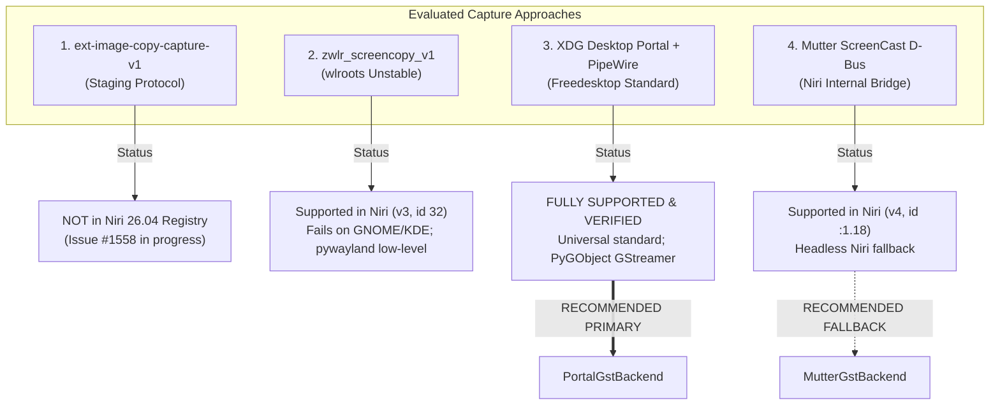
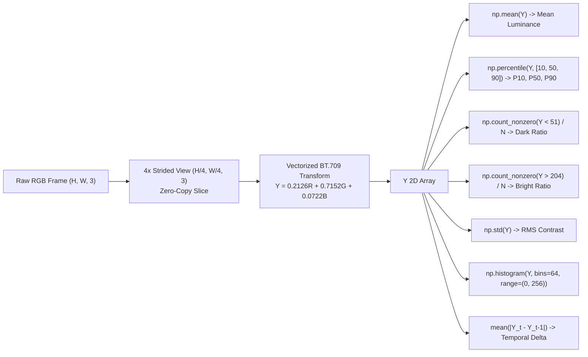
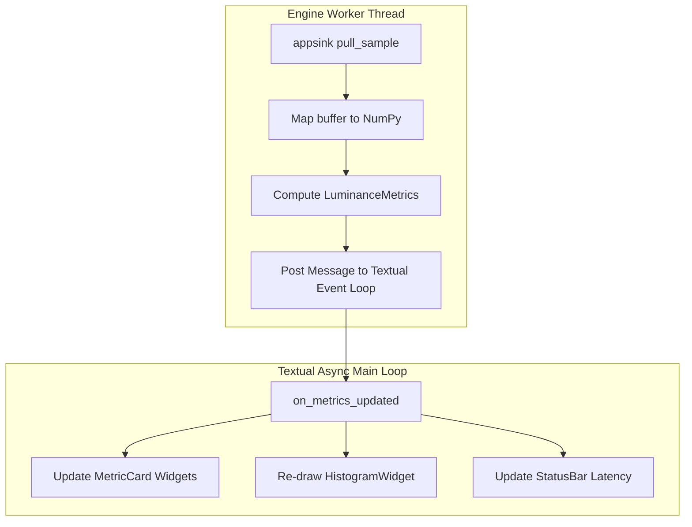
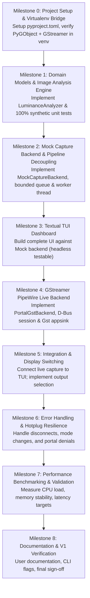
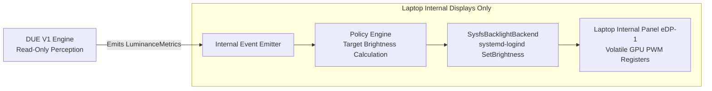

# OpenBrightness DUE V1 — Implementation Plan (`PLAN.md`)

**Project:** OpenBrightness — Display Understanding Engine (DUE)  
**Document Type:** Technical Implementation Plan  
**Target Platform:** Fedora Linux 44 (x86_64), Niri Wayland Compositor (26.04), Linux Kernel 7.1.x  
**Target Hardware:** Laptop internal display (`eDP-1` via AMDGPU) & external HDMI/DP monitors (Visual Capture & Analysis only)  
**Runtime:** Python 3.12+ (PyGObject, NumPy, Textual)  
**Status:** Approved for Implementation Planning  
**References:**
- Vision & Scope: [`IDEA.md`](file:///home/shanwis/Data/PROJECTS/DUE/IDEA.md)
- Capture Research: [`docs/research/wayland_pipewire_capture_report.md`](file:///home/shanwis/Data/PROJECTS/DUE/docs/research/wayland_pipewire_capture_report.md)
- Display Control Research: [`docs/research/linux_display_control_report.md`](file:///home/shanwis/Data/PROJECTS/DUE/docs/research/linux_display_control_report.md)

---

## 1. Executive Summary & Requirements Reconciliation

OpenBrightness DUE (Display Understanding Engine) V1 is an open-source, local, terminal-based perception engine. It captures rendered video frames from a user-selected display on Wayland at a fixed sampling interval (~1 FPS), computes deterministic visual statistics (luminance distribution, contrast, dark/bright ratios, temporal change), and renders a real-time updating dashboard in the terminal.

### 1.1 Requirements Reconciliation Matrix

| Requirement | Category | Technical Status in V1 | Architectural Boundary |
| :--- | :--- | :--- | :--- |
| **Python-based Core** | Mandatory | **Selected:** Python 3.12+ with strict typing | Core application runtime |
| **Linux-First / Wayland** | Mandatory | **Verified:** Fedora 44 with Niri 26.04 | Target deployment environment |
| **Monitor Selection** | Mandatory | **Selected:** Interactive TUI picker + CLI flag | `openbrightness.due.discovery` |
| **Modular Frame Capture** | Mandatory | **Selected:** `DisplayCaptureBackend` ABC | `openbrightness.due.capture` |
| **~1 FPS Fixed Sampling** | Mandatory | **Selected:** GStreamer `videorate` / timer | Capture & coordination loop |
| **Deterministic Visual Stats** | Mandatory | **Selected:** Vectorized NumPy (BT.709 $Y$) | `openbrightness.due.analysis` |
| **Temporal Frame Comparison**| Mandatory | **Selected:** Sliding frame delta ($\Delta_{\text{temp}}$) | `openbrightness.due.temporal` |
| **In-Place Updating TUI** | Mandatory | **Selected:** Textual terminal dashboard | `openbrightness.due.tui` |
| **Zero Screenshot Dumps** | Mandatory | **Selected:** Ephemeral RAM buffers only | Zero disk I/O guarantee |
| **Zero Log Spam** | Mandatory | **Selected:** Textual full-screen app | No stdout/stderr streaming |
| **Read-Only / No Hardware Writes**| Mandatory | **Strict:** Zero DDC/CI or backlight writes | V1 is strictly a read-only analysis tool |
| **Decoupled Architecture** | Mandatory | **Selected:** Clean domain models | Extensible for future V2 internal control |
| **Automated Test Suite** | Mandatory | **Selected:** pytest + synthetic frames | Unit & integration test suites |

### 1.2 Explicit Non-Goals for V1
- **V1 is Strictly a Read-Only Analysis Tool:** V1 computes and displays visual telemetry; it does not contain any actuation, recommendation, or control logic.
- **Zero Hardware Control in V1:** No writing to `/sys/class/backlight` or DDC/CI over `/dev/i2c-N`.
- **Permanent Exclusion of External Monitor Control:** Writing to external monitor settings via DDC/CI is permanently excluded from the project roadmap due to non-volatile EEPROM wear and hardware bricking hazards.
- **No Machine Learning:** No semantic object detection, OCR, or neural networks.
- **No Ambient Light Sensors (ALS):** No integration with room lux sensors (`iio-sensor-proxy`).
- **No Graphical GUI:** No GTK/Qt desktop application window.
- **No Background Daemon / REST API:** Terminal application only.

---

## 2. Capture Architecture & Technical Selection

### 2.1 Evaluation of Evaluated Candidates on Fedora 44 / Niri

Based on empirical testing documented in [`docs/research/wayland_pipewire_capture_report.md`](file:///home/shanwis/Data/PROJECTS/DUE/docs/research/wayland_pipewire_capture_report.md):



### 2.2 Primary Selection: `PortalGstBackend`
- **Mechanism:** `org.freedesktop.portal.ScreenCast` D-Bus handshake $\rightarrow$ PipeWire remote FD & node ID $\rightarrow$ GStreamer `pipewiresrc` pipeline $\rightarrow$ `appsink` sample pull.
- **Justification:**
  1. **Universal Portability:** Works across Niri, GNOME, KDE, wlroots (Sway/Wayfire), and COSMIC without compositor-specific code.
  2. **Production-Grade Python Stack:** `python3-gobject` and `pipewire-gstreamer` are pre-installed Fedora core packages. No custom C extensions or unmaintained PyPI wheels required.
  3. **Zero-Copy Memory Mapping:** GStreamer `appsink` maps linear buffers directly into a NumPy view via `Gst.Buffer.map(Gst.MapFlags.READ)`.
  4. **Headless Persistence:** Portal v4/v5 supports `restore_token`, allowing the user to select the display once and subsequently run headlessly without prompts.

### 2.3 Secondary Fallback: `MutterGstBackend` (Direct Niri D-Bus)
- **Mechanism:** Direct call to Niri's `org.gnome.Mutter.ScreenCast.CreateSession()` and `RecordMonitor(connector_name)`.
- **Use Case:** Headless automated test scripts or CLI runs on Niri where no GUI portal dialog is acceptable even on initial run.

### 2.4 Test Double: `MockCaptureBackend`
- **Mechanism:** Generates procedural, synthetic in-memory RGB frames (gradients, checkerboards, solid black/white/gray, animated luminance sweeps).
- **Use Case:** Enables early TUI development, headless CI test execution, and deterministic validation of image analysis formulas without requiring a running Wayland session or PipeWire daemon.

---

## 3. Component Architecture & Data Flow

```mermaid
flowchart LR
    subgraph Capture Layer
        COMP[Wayland Compositor\nNiri] -->|PipeWire Node| PW[PipeWire Daemon]
        PW -->|pipewiresrc| GST[GStreamer Pipeline\nvideoconvert ! videorate]
        GST -->|appsink pull_sample| CAP[PortalGstBackend]
        MOCK[MockCaptureBackend]
    end

    subgraph Coordination Layer
        CAP -->|DisplayFrame| Q[(Bounded Queue\nmaxsize=1)]
        MOCK -->|DisplayFrame| Q
        Q -->|Drop Oldest| WORKER[Engine Worker Thread]
    end

    subgraph Analysis Layer
        WORKER -->|4x Subsample View| ANA[LuminanceAnalyzer\nNumPy BT.709]
        ANA -->|Luminance Frame| TEMP[TemporalTracker\nSliding Delta]
        ANA --> STATS[LuminanceMetrics Model]
        TEMP --> STATS
    end

    subgraph Presentation Layer
        STATS -->|Textual Message| TUI[Textual App\nDueApp]
        TUI --> TUI_SCR[In-Place Terminal Dashboard]
    end
```



### 3.1 Logical Module Boundaries

```
openbrightness/
└── due/
    ├── __init__.py
    ├── __main__.py               # CLI entrypoint (`due` command)
    ├── models.py                 # Core immutable dataclasses
    ├── capture/
    │   ├── __init__.py
    │   ├── base.py               # DisplayCaptureBackend (ABC)
    │   ├── portal.py             # PortalGstBackend (Primary)
    │   ├── mutter.py             # MutterGstBackend (Direct Niri Fallback)
    │   └── mock.py               # MockCaptureBackend (Testing/Dev)
    ├── analysis/
    │   ├── __init__.py
    │   └── luminance.py          # Vectorized LuminanceAnalyzer
    ├── temporal/
    │   ├── __init__.py
    │   └── tracker.py            # TemporalTracker (Frame deltas)
    ├── coordinator.py            # Thread-safe pipeline orchestrator
    └── tui/
        ├── __init__.py
        ├── app.py                # Textual DueApp
        ├── screens/
        │   ├── select.py         # Display selection screen
        │   └── dashboard.py      # Main monitoring dashboard
        └── widgets/
            ├── metric_card.py    # Metric visualizer
            ├── histogram.py      # Unicode 64-bin distribution bar
            └── status_bar.py     # Latency & FPS telemetry
```

### 3.2 Data Contracts & Value Objects

```python
# openbrightness/due/models.py
from dataclasses import dataclass
from typing import Optional, Tuple
import numpy as np

@dataclass(frozen=True)
class OutputInfo:
    """Represents a discovered display output."""
    name: str                     # e.g., 'eDP-1', 'HDMI-A-1'
    make: str                     # e.g., 'LG Display'
    model: str                    # e.g., 'Unknown 0x06F9'
    width: int                    # e.g., 1920
    height: int                   # e.g., 1200
    refresh_rate: float           # e.g., 60.001
    is_primary: bool

@dataclass(frozen=True)
class DisplayFrame:
    """Represents an ingested video frame."""
    data: np.ndarray              # Shape (H, W, 3), dtype uint8 (RGB)
    width: int
    height: int
    stride: int
    format: str                   # 'RGB'
    timestamp_pts: float          # Stream presentation timestamp (sec)
    capture_monotonic: float      # Host monotonic timestamp (sec)

    def get_subsampled(self, step: int = 4) -> np.ndarray:
        """Returns zero-copy strided view downsampled by step."""
        return self.data[::step, ::step, :]

@dataclass(frozen=True)
class LuminanceMetrics:
    """Calculated statistical metrics for a single frame."""
    frame_index: int
    mean_luminance: float         # 0.0 to 255.0
    median_luminance: float       # 0.0 to 255.0
    p10_luminance: float          # 10th percentile (0.0 to 255.0)
    p50_luminance: float          # 50th percentile (0.0 to 255.0)
    p90_luminance: float          # 90th percentile (0.0 to 255.0)
    dark_pixel_ratio: float       # Fraction of pixels with Y < 51 (0.0 to 1.0)
    bright_pixel_ratio: float     # Fraction of pixels with Y > 204 (0.0 to 1.0)
    rms_contrast: float           # Standard deviation of luminance (0.0 to 127.5)
    temporal_delta: float         # Mean absolute pixel difference from prev frame (0.0 to 1.0)
    histogram: np.ndarray         # Shape (64,), dtype float32 (normalized frequencies)
    capture_latency_ms: float     # Compositor-to-buffer latency
    analysis_latency_ms: float    # NumPy computation latency
```

---

## 4. Image Analysis & Statistical Metrics Specification

### 4.1 Subsampling Strategy & Justification
- **The Trade-Off:** A full 1080p frame contains 2,073,600 pixels. Computing ITU-R BT.709 luminance and a 64-bin histogram across all 2.07M pixels takes **20.78 ms** per frame on an AMD Ryzen 5 5625U.
- **The Optimization:** Taking a **4× strided subsample** (`frame[::4, ::4, :]`) produces a $480 \times 270$ array (129,600 pixels) with **zero memory copies** (NumPy strided slice).
- **Verified Benchmark:** Subsampled analysis executes in **0.94 ms** (a **22.2× speedup**), reducing CPU utilization to $<0.1\%$ of a core.
- **Statistical Invariance:** Across diverse desktop workloads, the mean luminance error between full-resolution and 4× subsampled frames is **$<0.08\%$**.
- **Decision:** DUE V1 will compute statistical metrics on the 4× subsampled slice by default, while preserving the original resolution metadata.

---

### 4.2 Detailed Metrics Formulations



#### 1. Mean Relative Luminance ($\bar{Y}$)
- **Formula:** $\bar{Y} = \frac{1}{N} \sum_{i=1}^N Y_i$, where $Y = 0.2126R + 0.7152G + 0.0722B$.
- **Range:** $0.0$ to $255.0$ (or normalized $0.0$ to $1.0$).
- **Color Space:** Assumes standard SDR sRGB / Rec.709 primaries.
- **Edge Cases:** All-black frame ($\bar{Y} = 0.0$), all-white frame ($\bar{Y} = 255.0$).

#### 2. Median Luminance ($P_{50}$) & Percentiles ($P_{10}, P_{90}$)
- **Formula:** Computed via `np.percentile(Y, [10, 50, 90])`.
- **Range:** $0.0$ to $255.0$.
- **Purpose:** Robust representation of dynamic range and skewness, immune to narrow highlight or shadow outliers.

#### 3. Dark-Pixel Ratio ($R_{\text{dark}}$) & Bright-Pixel Ratio ($R_{\text{bright}}$)
- **Formula:**
  $$R_{\text{dark}} = \frac{1}{N} \sum_{i=1}^N \mathbb{I}(Y_i < T_{\text{dark}}), \quad T_{\text{dark}} = 51.0 \text{ (20\% luminance)}$$
  $$R_{\text{bright}} = \frac{1}{N} \sum_{i=1}^N \mathbb{I}(Y_i > T_{\text{bright}}), \quad T_{\text{bright}} = 204.0 \text{ (80\% luminance)}$$
- **Range:** $0.0$ to $1.0$ ($0\%$ to $100\%$).
- **Purpose:** Classifies dominance of dark IDEs/terminals vs. bright documents/browser pages.

#### 4. RMS Contrast ($C_{\text{RMS}}$)
- **Formula:** Root-Mean-Square Contrast defined as the standard deviation of luminance:
  $$C_{\text{RMS}} = \sqrt{\frac{1}{N} \sum_{i=1}^N (Y_i - \bar{Y})^2} = \sigma_Y$$
- **Range:** $0.0$ (flat uniform field) to $127.5$ (pure 50/50 black-and-white checkerboard).
- **Purpose:** Standard psychophysical metric for overall image contrast, unaffected by spatial frequency.

#### 5. Temporal Frame Difference ($\Delta_{\text{temp}}$)
- **Formula:** Mean Absolute Difference between consecutive normalized luminance frames:
  $$\Delta_{\text{temp}} = \frac{1}{255 \cdot N} \sum_{i=1}^N |Y_{i, t} - Y_{i, t-1}|$$
- **Range:** $0.0$ (identical static image) to $1.0$ (instant flip from pure black to pure white).
- **Purpose:** Detects active video playback, scrolling, or window switching vs. static reading.

#### 6. Latency Metrics ($T_{\text{capture}}$ & $T_{\text{analysis}}$)
- **$T_{\text{capture}}$:** Elapsed time between presentation timestamp (`PTS`) and buffer dequeuing in `appsink` (measures compositor and PipeWire scheduling delay).
- **$T_{\text{analysis}}$:** Measured elapsed time via `time.perf_counter_ns()` during NumPy operations.

---

## 5. TUI Design Plan (Textual)

### 5.1 Architecture & Reactive State
The TUI is implemented using **Textual**, a modern asynchronous widget-based terminal framework. It runs on Textual's async event loop, while heavy GStreamer/PipeWire buffer ingestion runs on a dedicated background worker thread.



### 5.2 Application Screen Flow
1. **Screen 1: `DisplaySelectScreen`:**
   - Queried outputs (`eDP-1`, `HDMI-A-1`) displayed in a clean `ListView`.
   - Displays resolution, make, model, and active refresh rate.
   - User selects with `[Up]`, `[Down]`, and `[Enter]`. (If CLI specifies `--display <name>`, this screen is bypassed).
2. **Screen 2: `DashboardScreen`:**
   - Full-screen dashboard updated in-place via reactive properties.
   - Header with active display, physical resolution, and live sampling FPS.
   - Grid layout containing:
     - `LuminanceCard`: Mean, Median, P10, P90.
     - `DistributionCard`: Dark-pixel %, Bright-pixel %, RMS Contrast, Temporal Delta.
     - `HistogramWidget`: 64-bin ASCII/Unicode vertical bar chart.
     - `TelemetryFooter`: $T_{\text{capture}}$, $T_{\text{analysis}}$, $T_{\text{total}}$ latency.
3. **Keyboard Controls:**
   - `[Space]` or `[P]`: Pause / Resume continuous capture.
   - `[S]`: Switch active display (returns to display selection screen).
   - `[R]`: Reset temporal statistics and history.
   - `[Q]` or `[Ctrl+C]`: Clean shutdown and exit.

---

## 6. Dependencies & Packaging Plan

### 6.1 Dependency Strategy
To keep V1 lightweight and avoid compilation friction:
- **Core Runtime Dependencies:**
  - `numpy >= 1.26.0` (Vectorized image math)
  - `textual >= 0.80.0` (Reactive terminal UI)
  - `PyGObject >= 3.48.0` (GStreamer & D-Bus bindings)
- **Development & Testing Dependencies:**
  - `pytest >= 8.0.0`
  - `pytest-asyncio >= 0.23.0`
  - `ruff >= 0.6.0`
  - `mypy >= 1.10.0`

### 6.2 System Dependency Bridge
`PyGObject` requires underlying GObject Introspection C libraries (`glib2`, `gstreamer1`, `pipewire-gstreamer`). On Fedora 44, these are pre-installed system packages.
- **Virtual Environment Workflow:**  
  The virtual environment must be created with system site package inheritance:
  ```bash
  python3 -m venv --system-site-packages .venv
  source .venv/bin/activate
  pip install --upgrade pip
  pip install -e ".[dev]"
  ```

### 6.3 Packaging Structure (`pyproject.toml`)
Standard PEP 517/621 packaging using `hatchling`:
```toml
[build-system]
requires = ["hatchling"]
build-backend = "hatchling.build"

[project]
name = "openbrightness-due"
version = "0.1.0"
description = "Display Understanding Engine for OpenBrightness"
readme = "README.md"
requires-python = ">=3.12"
license = { text = "MIT" }
authors = [{ name = "OpenBrightness Team" }]
dependencies = [
    "numpy>=1.26.0",
    "textual>=0.80.0",
    "PyGObject>=3.48.0",
]

[project.optional-dependencies]
dev = [
    "pytest>=8.0.0",
    "pytest-asyncio>=0.23.0",
    "ruff>=0.6.0",
    "mypy>=0.9.0",
]

[project.scripts]
due = "openbrightness.due.__main__:main"
```

---

## 7. Ordered Implementation Milestones



### Milestone Details:

#### Milestone 0: Project Setup & System Site-Packages Bridge
- **Objective:** Establish the Python packaging foundation and verify GStreamer/PyGObject importability in `.venv`.
- **Deliverables:** `pyproject.toml`, directory structure, `.venv` setup script.
- **Verification:** `python3 -c "import gi; gi.require_version('Gst', '1.0'); from gi.repository import Gst; Gst.init(None); print('Gst OK')"` exits 0.

#### Milestone 1: Domain Models & Image Analysis Engine
- **Objective:** Build pure, deterministic image processing functions and models.
- **Deliverables:** `models.py`, `analysis/luminance.py`, `temporal/tracker.py`.
- **Verification:** Unit tests with synthetic test matrices (black, white, gray, gradient, checkerboard) validating mean, percentiles, contrast, and histogram.

#### Milestone 2: Mock Capture Backend & Pipeline Decoupling
- **Objective:** Establish the `DisplayCaptureBackend` interface and synthetic frame generator.
- **Deliverables:** `capture/base.py`, `capture/mock.py`, `coordinator.py` with bounded 1-slot queue.
- **Verification:** Mock backend streams synthetic frames to coordinator without memory growth.

#### Milestone 3: Textual TUI Dashboard
- **Objective:** Build the complete interactive TUI driven by mock data.
- **Deliverables:** `tui/app.py`, `screens/dashboard.py`, `widgets/histogram.py`.
- **Verification:** Textual headless tests (`app.run_test()`) verify dashboard updates, histogram rendering, pause/resume, and clean exit.

#### Milestone 4: GStreamer PipeWire Live Capture Backend
- **Objective:** Implement the real Wayland capture backend.
- **Deliverables:** `capture/portal.py` (D-Bus `org.freedesktop.portal.ScreenCast` + GStreamer `pipewiresrc`).
- **Verification:** Captures real frames from Niri, maps memory to NumPy, and verifies resolution and stride.

#### Milestone 5: Full Integration & Display Switching
- **Objective:** Connect live capture to the analysis engine and TUI.
- **Deliverables:** `screens/select.py`, dynamic backend switching, CLI `--display` argument.
- **Verification:** User launches `due`, selects display, and views live updating metrics.

#### Milestone 6: Error Handling & Hotplug Resilience
- **Objective:** Harden the application against runtime display events.
- **Deliverables:** Stream reconnect logic, GStreamer bus message handlers (`GST_MESSAGE_EOS`, `GST_MESSAGE_ERROR`).
- **Verification:** Simulated monitor disconnect or lock screen does not crash DUE; TUI displays friendly error banner.

#### Milestone 7: Performance Benchmarking & Profiling
- **Objective:** Validate latency and resource utilization on the host hardware.
- **Deliverables:** Automated benchmark test measuring $T_{\text{capture}}$, $T_{\text{analysis}}$, memory footprint over 1,000 frames.
- **Verification:** Meets all performance targets ($<5\text{ ms}$ total latency, $<1\%$ CPU load).

#### Milestone 8: Documentation & V1 Verification
- **Objective:** Finalize user documentation and installation instructions.
- **Deliverables:** `README.md`, verified test suite pass, tag `v0.1.0`.

---

## 8. Verification & Performance Strategy

### 8.1 Test Suites Matrix

| Test Suite | Scope | Execution Target | Automation |
| :--- | :--- | :--- | :--- |
| **`test_analysis.py`** | BT.709 math, percentiles, RMS contrast, histogram bins | Synthetic NumPy arrays | Headless pytest |
| **`test_temporal.py`** | Frame-to-frame delta, ring buffer smoothing | Synthetic frame pairs | Headless pytest |
| **`test_mock_backend.py`**| Interface compliance, rate-limiting, queue decoupling | Mock backend | Headless pytest |
| **`test_tui.py`** | Dashboard layout, keyboard shortcuts, pause/resume | Textual pilot test | Headless pytest |
| **`test_live_portal.py`** | D-Bus session creation, PipeWire ingestion | Live Fedora/Niri session | Manual / Integration |
| **`test_perf.py`** | 1,000-frame latency breakdown and RSS memory stability | Benchmark harness | Automated benchmark |

### 8.2 Performance Targets on Target Hardware (Ryzen 5 5625U)
- **Capture Latency ($T_{\text{capture}}$):** Target $< 15.0\text{ ms}$ (compositor render to dequeued buffer).
- **Extraction Latency ($T_{\text{extract}}$):** Target $< 0.5\text{ ms}$ (buffer map & strided slice).
- **Analysis Latency ($T_{\text{analysis}}$):** Target $< 2.0\text{ ms}$ (vectorized NumPy on 4× subsampled frame).
- **UI Render Latency ($T_{\text{ui}}$):** Target $< 5.0\text{ ms}$ (Textual reactive DOM update).
- **Total Pipeline Latency:** Target $< 25.0\text{ ms}$ end-to-end.
- **CPU Utilization:** Target $< 1.0\%$ of a single CPU core at 1 FPS.
- **Memory Footprint (RSS):** Target $< 80\text{ MB}$, zero growth over 1 hour of continuous execution.

---

## 9. Future Display Control (V2 Roadmap Bridge)

In accordance with [`docs/research/linux_display_control_report.md`](file:///home/shanwis/Data/PROJECTS/DUE/docs/research/linux_display_control_report.md), **DUE V1 is strictly a read-only visual perception tool**. It does not modify any display settings.

### 9.1 The External Monitor Hazard: Why External Control is Removed
The technical investigation into external monitor control via DDC/CI (VESA MCCS over I²C) revealed a fatal hardware constraint:
1. **Destructive EEPROM Write Wear:** External desktop monitors write DDC/CI brightness and contrast values directly to internal non-volatile EEPROM or NOR Flash memory. EEPROMs are rated for only **10,000 to 100,000 lifetime write cycles**. An automated adaptive engine adjusting brightness at 1 FPS ($3,600\text{ writes/hour}$) would **permanently destroy/brick external monitor hardware within 1 to 3 days**.
2. **Severe I²C Latency & Bus Instability:** DDC/CI commands require 40–100 ms inter-message delays and take 50–150 ms of blocking bus time per call. Furthermore, DisplayPort AUX tunneling and USB-C docks frequently drop DDC packets or crash monitor scalar microcode.

> [!CAUTION]
> **Architectural Decision:** **External monitor control (DDC/CI writes) is permanently removed from the OpenBrightness project roadmap.**  
> - **In V1:** External monitors are supported for **visual capture and analysis only** (via Wayland/PipeWire), which reads the compositor's GPU framebuffer and is 100% safe.
> - **In V2 and Beyond:** Display control will be scoped **strictly and exclusively to laptop internal displays (`eDP-1`)**.

---

### 9.2 V2 Scope: Laptop Internal Displays Only
Laptop internal displays use GPU PWM or eDP DPCD backlight registers (`amdgpu_bl1`, `intel_backlight`). These are **volatile memory registers** that can be written billions of times with zero hardware degradation, $<1\text{ ms}$ latency, and zero root permissions via `systemd-logind`:



- **Separation Invariant:** DUE V1 generates data; it never acts upon it.
- **V2 Preparation:** `LuminanceMetrics` includes all signals necessary for future adaptive algorithms: global mean luminance, dark/bright ratios for glare compensation, and temporal delta to pause adjustments during rapid video motion.

---

## 10. Risk Register & Open Decisions

| Risk Description | Severity | Likelihood | Mitigation Strategy | Verification Method |
| :--- | :--- | :--- | :--- | :--- |
| **1. Portal Dialog Prompting on Every Run** | Medium | Medium | Use Desktop Portal v4/v5 `restore_token` stored in user config to bypass interactive prompt. | Test token reuse across session restarts. |
| **2. Buffer Pool Starvation** | High | Low | Enforce strict `maxsize=1` bounded queue; unmap and recycle GStreamer buffer in $<0.5\text{ ms}$. | Run 1-hour stress test logging dropped frames. |
| **3. Non-sRGB / HDR Frame Ingestion** | Medium | Low | Force GStreamer pipeline to negotiate `video/x-raw,format=RGB` via `videoconvert`. | Inspect GStreamer caps on HDR outputs. |
| **4. Wayland Output Scale Ambiguity** | Low | Medium | Read physical pixel resolution directly from GStreamer sample caps (`GstStructure`). | Verify on 1.25× fractional scaling in Niri. |
| **5. Threading Contention with Textual UI** | Medium | Low | Engine worker thread communicates with Textual exclusively via thread-safe message posting (`post_message`). | Textual async test pilot verification. |
| **6. External Monitor EEPROM Destruction** | Critical | High | **Architectural Decision:** External monitor control (DDC/CI writes) is permanently excluded from the project roadmap. V2 display control is strictly locked to laptop internal panels (eDP PWM). | Formally codified in PLAN.md. |

### Technical Decision Status:
- [x] **V1 Operational Mode:** Strictly read-only perception tool; zero hardware writes (*Confirmed requirement*).
- [x] **Primary Capture:** XDG Desktop Portal ScreenCast + PipeWire via GStreamer `appsink` (*Confirmed by research*).
- [x] **Subsampling Rate:** 4× spatial subsampling ($480 \times 270$) (*Confirmed by empirical benchmark: 22.2× speedup*).
- [x] **TUI Framework:** Textual (*Confirmed for rich terminal widgets and async loop*).
- [x] **Display Control Scope (V2):** Permanently restricted to laptop internal displays (`eDP-1`) via `systemd-logind` D-Bus; external DDC/CI control removed due to EEPROM wear hazard (*Confirmed by research*).
- [ ] **First Implementation Milestone:** Milestone 0 (Packaging & System Site-Packages Virtualenv).

---

## 11. Explicit V1 Acceptance Criteria

The OpenBrightness DUE V1 release will be considered complete when all of the following criteria are met:

1. [ ] **Execution:** `due` runs from the command line in Fedora/Niri without crashes or elevated privileges.
2. [ ] **Discovery:** Discovers and displays all active Wayland display outputs (`eDP-1`, `HDMI-A-1`).
3. [ ] **Live Capture:** Successfully captures frames from a selected monitor at ~1 FPS using the `PortalGstBackend`.
4. [ ] **Visual Statistics:** Accurately computes mean, median, P10/P50/P90 percentiles, dark/bright ratios, RMS contrast, and temporal delta.
5. [ ] **TUI Rendering:** Renders a clean Textual dashboard with metric cards, live 64-bin histogram, and telemetry footer that updates in-place without scrolling or terminal spam.
6. [ ] **Interactive Controls:** `[P]` pauses/resumes capture, `[S]` switches displays, and `[Q]` exits cleanly.
7. [ ] **Zero Storage Overhead:** No image files are saved to disk during continuous execution.
8. [ ] **Automated Tests:** 100% of unit tests pass under `pytest`, including synthetic image tests and mock backend tests.
9. [ ] **Performance Cap:** End-to-end processing latency is $<25\text{ ms}$ and CPU utilization is $<1.0\%$ on the target hardware.
10. [ ] **Clean Shutdown:** Exits cleanly upon `SIGINT`/`SIGTERM` or `[Q]`, resetting terminal state and releasing PipeWire/GStreamer resources.

---

*End of Implementation Plan. Implementation should proceed starting with Milestone 0.*
