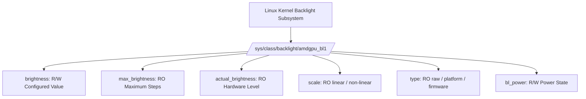
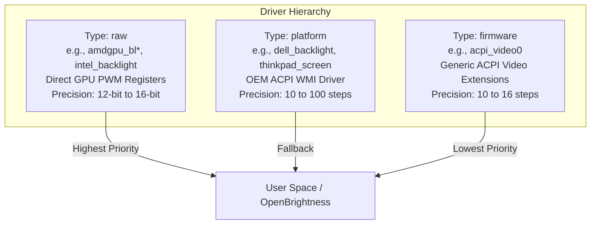
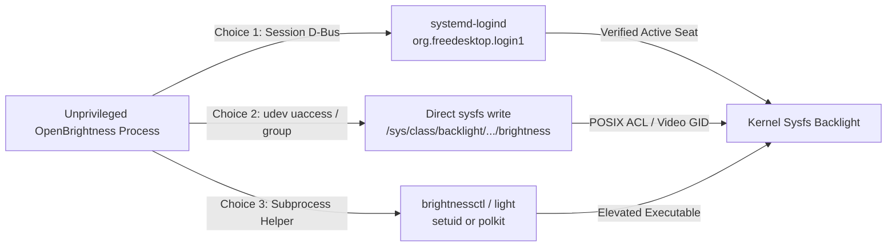
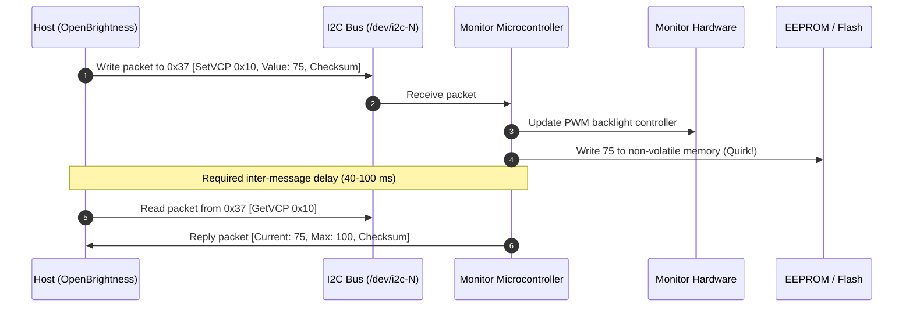
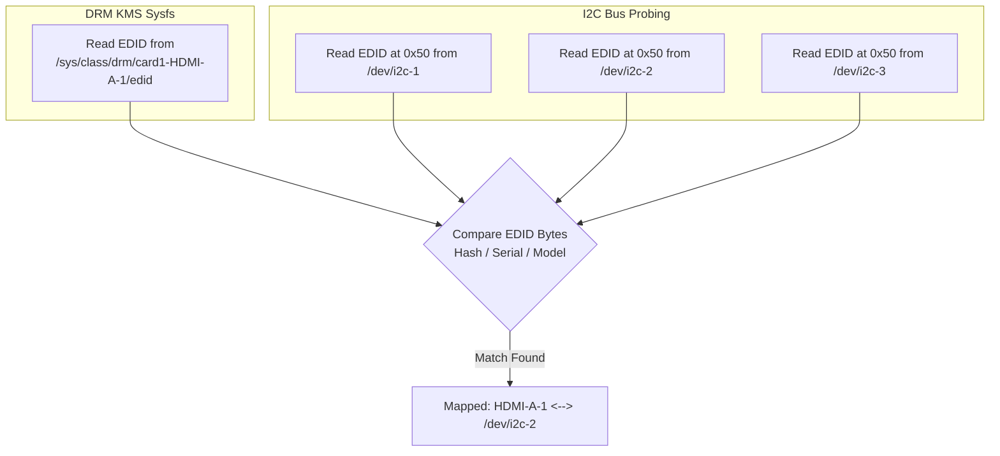
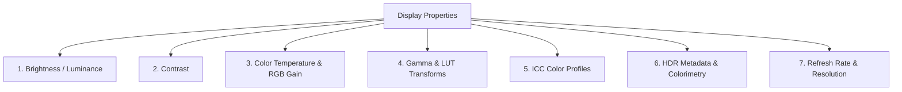
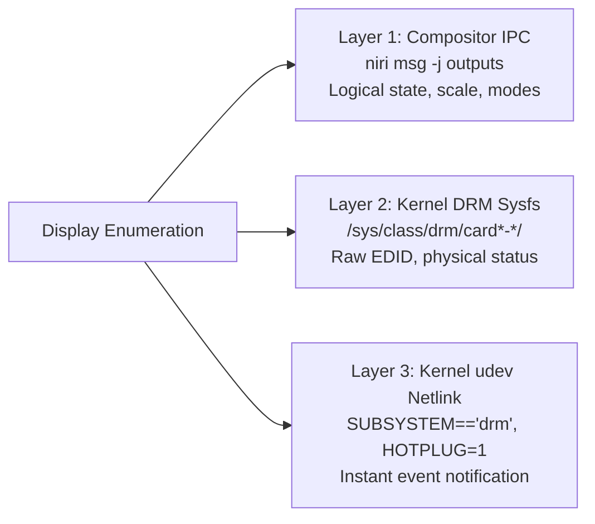
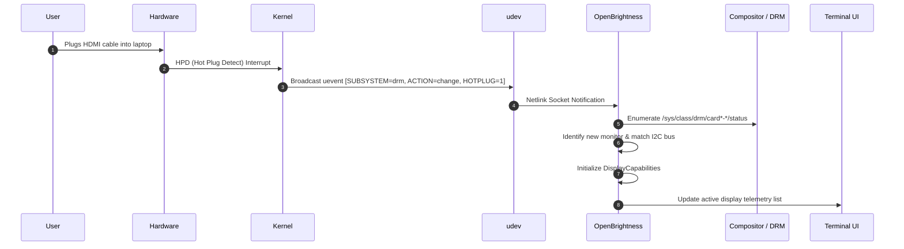
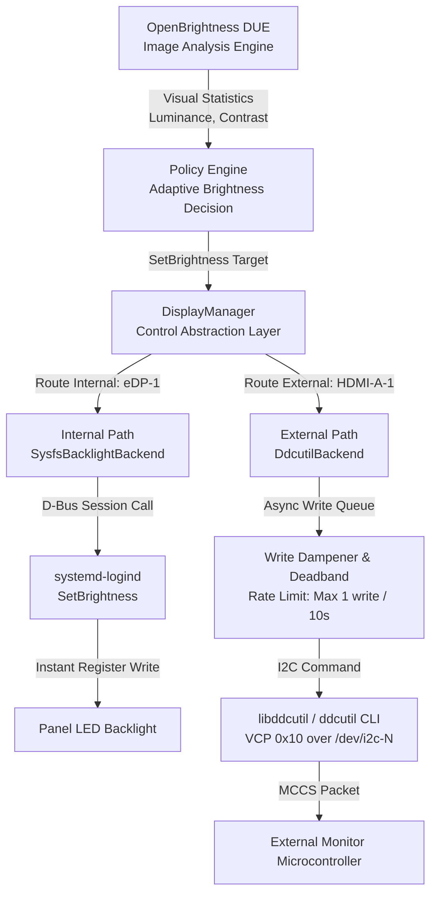
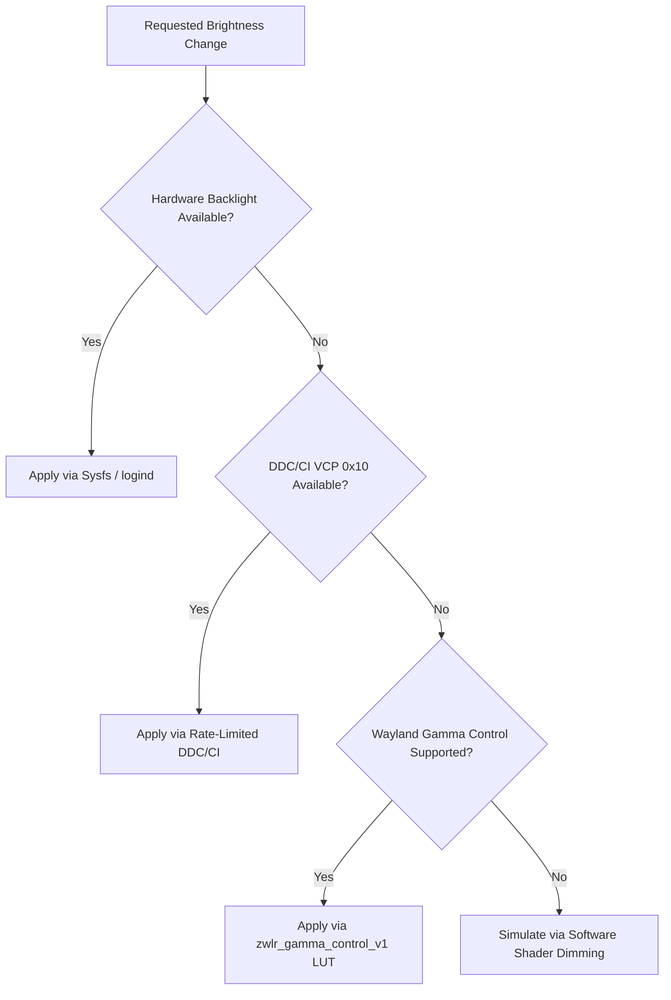

# Linux Display Control Capabilities for OpenBrightness

**Project:** OpenBrightness — Display Understanding Engine (DUE)  
**Author:** Technical Architecture Research  
**Target Environment:** Fedora Linux 44 (x86_64), Niri Wayland Compositor (26.04), Linux Kernel 7.1.x, PipeWire (1.6.8)  
**Target Hardware:** Laptop internal display (eDP-1 / AMDGPU) and external monitor (HDMI / DisplayPort)  
**Date:** October 2026  
**Status:** Technical Investigation & Architecture Specification (Future Display Control Phase)  

---

## Table of Contents

1. [Executive Summary & Scope Definition](#1-executive-summary--scope-definition)
2. [Internal Laptop Display Control (`/sys/class/backlight`)](#2-internal-laptop-display-control-sysclassbacklight)
   - 2.1 Sysfs Architecture & Attributes
   - 2.2 Driver Hierarchy & Types (`raw` vs. `platform` vs. `firmware`)
   - 2.3 Privilege & Permission Models
   - 2.4 Reliable Observation of Brightness Changes
   - 2.5 Interactions with Automatic Brightness Daemons (ALS)
   - 2.6 Physical Backlight Control vs. Software Dimming
3. [External Monitor Control via DDC/CI & `ddcutil`](#3-external-monitor-control-via-ddcci--ddcutil)
   - 3.1 Physical Layer & VESA MCCS Protocol Stack
   - 3.2 Standard VCP Feature Codes
   - 3.3 Hardware Realities, Readability & Firmware Quirks
   - 3.4 Output-to-DDC Device Mapping
   - 3.5 Cable, Dock, and Adapter Compatibility
   - 3.6 Permissions & I²C Access on Fedora
   - 3.7 `ddcutil` CLI vs. `libddcutil` C API for Python Integration
   - 3.8 Flash/EEPROM Write Wear: The Critical Danger of High-Frequency Writes
4. [Comprehensive Analysis of Other Display Properties](#4-comprehensive-analysis-of-other-display-properties)
   - 4.1 Property-by-Property Feasibility Breakdown
   - 4.2 Categorization Matrix (Hardware vs. Compositor vs. Software)
   - 4.3 Conflicts, Visual Artifacts & Ecosystem Interactions
5. [Display Identification, Enumeration, and Hotplugging](#5-display-identification-enumeration-and-hotplugging)
   - 5.1 Enumeration Interfaces (Wayland/Niri vs. DRM KMS vs. udev)
   - 5.2 Stable Identity Strategy & The Duplicate Monitor Challenge
   - 5.3 Hotplug Detection Architecture
   - 5.4 Correlation Algorithm: Compositor Output $\leftrightarrow$ DRM Connector $\leftrightarrow$ I²C Bus
6. [Comparative Evaluation Matrices](#6-comparative-evaluation-matrices)
   - 6.1 Display Properties to Linux Interfaces & Limitations
   - 6.2 Control Mechanism Trade-Off Matrix
7. [Recommended Display Control Strategy](#7-recommended-display-control-strategy)
   - 7.1 Dual-Path Control Architecture
   - 7.2 Graceful Fallback Hierarchy
8. [Proposed Extensible Python Control Architecture](#8-proposed-extensible-python-control-architecture)
   - 8.1 Architectural Decoupling from DUE Analysis Engine
   - 8.2 Data Models & Value Objects
   - 8.3 Core Interface Specification (`DisplayBackend`)
   - 8.4 Concrete Backend Implementations (`SysfsBacklightBackend`, `DdcutilBackend`, `SoftwareGammaBackend`)
   - 8.5 `DisplayManager` & Asynchronous Write Dampener
9. [Practical Hardware Validation Plan for Fedora/Niri](#9-practical-hardware-validation-plan-for-fedoraniri)
10. [Safety Considerations & Risk Mitigations](#10-safety-considerations--risk-mitigations)
    - 10.1 EEPROM Endurance & Write Wear Mitigation
    - 10.2 Preserving User Baseline & State Restoration
    - 10.3 Manual Override & Auto-Inhibition Timers
    - 10.4 Failsafe Minimum Brightness Clamps
11. [Official References and Standards](#11-official-references-and-standards)

---

## 1. Executive Summary & Scope Definition

### 1.1 Context & Objective
OpenBrightness is designed as an open-source, Linux-first display management system. Its foundational component, the **Display Understanding Engine (DUE)**, analyzes real-time visual output (luminance distribution, contrast, dark/bright ratios) from a user-selected monitor.

While DUE V1 is strictly a read-only terminal application that captures and reports image statistics without altering hardware states, future versions will leverage these visual statistics to provide adaptive display adjustments (e.g., content-adaptive brightness, ambient contrast optimization, eye-strain mitigation).

This research investigation analyzes:
1. Which display properties can be read and modified across internal laptop panels and external monitors under Linux.
2. Which kernel, D-Bus, compositor, and I²C interfaces expose these capabilities.
3. How OpenBrightness should architect its future display-control layer to remain strictly decoupled from the image-analysis pipeline, robust against hardware quirks, and safe against hardware degradation.

### 1.2 Core Architectural Findings
- **Internal Laptop Displays:** Controlled via the Linux kernel's `/sys/class/backlight/` subsystem. On modern systems, direct write permissions to sysfs files require root, but unprivileged desktop applications can reliably execute adjustments via **`systemd-logind`'s Session D-Bus API (`SetBrightness`)** or standard uaccess udev rules.
- **External Monitors:** Controlled via **DDC/CI (Display Data Channel / Command Interface)** over the I²C bus using VESA MCCS (Monitor Control Command Set) standards. Handled reliably on Linux via **`ddcutil` / `libddcutil`**.
- **The EEPROM Wear Hazard:** Unlike internal laptop backlights (which modulate PWM registers in volatile GPU memory), external monitors frequently write DDC/CI settings directly to non-volatile EEPROM/Flash memory. **High-frequency adaptive writes (e.g., 1 write per second) will permanently destroy monitor hardware within days.** Adaptive display control must implement aggressive deadbanding, rate-limiting, and hysteresis.
- **Decoupled Architecture:** Display control must be fully abstracted behind an asynchronous, non-blocking `DisplayManager` interface. The DUE analysis engine must produce purely mathematical metrics; a separate policy engine decides adjustments, and backend workers execute them asynchronously to prevent I²C communication delays (50–150 ms) from blocking frame analysis or terminal rendering.

---

## 2. Internal Laptop Display Control (`/sys/class/backlight`)

### 2.1 Sysfs Architecture & Attributes
The Linux kernel exposes internal display panel backlight controllers through sysfs at `/sys/class/backlight/<device>/`.



On the test laptop (AMD Ryzen 5 5625U, Fedora 44), the sysfs interface is located at `/sys/class/backlight/amdgpu_bl1/` linked to `/sys/devices/pci.../drm/card1/card1-eDP-1/amdgpu_bl1`.

The standard sysfs attributes are:
- **`max_brightness` (read-only):** An integer defining the maximum discrete brightness level. On the test machine, this is `65535` (16-bit PWM resolution). On Intel GPUs, it is typically `1060` to `96000`; on ACPI video devices, it is typically `100` or `15`.
- **`brightness` (read/write):** The currently requested brightness level. Writing an ASCII integer string to this file instructs the driver to alter panel luminance.
- **`actual_brightness` (read-only):** The actual hardware brightness level currently reported by the panel or PWM driver. This may differ from `brightness` during smooth hardware-ramping transitions, when the panel is in power-saving states, or when overridden by hardware firmware.
- **`scale` (read-only):** Indicates whether brightness steps map linearly (`linear`) or logarithmically (`non-linear`) to human perceptual luminance. AMDGPU reports `non-linear` on the test hardware.
- **`type` (read-only):** Classification of the underlying driver implementation (`raw`, `platform`, or `firmware`).
- **`bl_power` (read/write):** Controls panel backlight power: `0` (FB_BLANK_UNBLANK), `1` (FB_BLANK_NORMAL), `2` (FB_BLANK_VSYNC_SUSPEND), `3` (FB_BLANK_HSYNC_SUSPEND), `4` (FB_BLANK_POWERDOWN).

---

### 2.2 Driver Hierarchy & Types (`raw` vs. `platform` vs. `firmware`)

The Linux kernel may expose multiple backlight devices for a single physical screen if the GPU driver, ACPI platform driver, and BIOS ACPI video driver all register handlers:



1. **`raw` (GPU Hardware Registers / PWM):**
   - Implemented directly by GPU DRM drivers (`amdgpu_bl1`, `intel_backlight`, `nouveau_bl*`).
   - Modulates the GPU's hardware PWM (Pulse Width Modulation) pin or embedded DisplayPort (eDP) DPCD registers directly.
   - Granularity is high (typically 12-bit to 16-bit, $4096$ to $65535$ steps).
   - Instantaneous response with zero ACPI firmware latency.
2. **`platform` (Vendor ACPI / WMI Extensions):**
   - Implemented by vendor platform drivers (`dell_backlight`, `thinkpad_screen`, `asus_wmi`, `ideapad_laptop`).
   - Communicates with the motherboard Embedded Controller (EC) via ACPI methods.
   - Coarser step resolution; potential EC latency.
3. **`firmware` (Standard ACPI Video):**
   - Implemented by the generic ACPI video driver (`acpi_video0`, `acpi_video1`).
   - Uses standard ACPI `_BCM` (Brightness Control Method) and `_BQC` (Brightness Query Current).
   - Often exhibits coarse granularity (0–100 or 0–15) and can be buggy on modern UEFI firmware.

#### Selection Policy for OpenBrightness:
The Linux kernel and `systemd-backlight` enforce a strict selection precedence: **`raw` > `platform` > `firmware`**. OpenBrightness must inspect all directories in `/sys/class/backlight/`, filter for the device associated with the target `eDP` connector, and select the device with the highest driver type precedence.

---

### 2.3 Privilege & Permission Models

By default on Linux, `/sys/class/backlight/<device>/brightness` has file permissions `-rw-r--r--` owned by `root:root`. An unprivileged desktop process attempting to write directly to this file receives `errno = 13 (EACCES Permission denied)`.

To allow an unprivileged application to modify internal brightness safely, three mechanisms exist:



1. **`systemd-logind` Session D-Bus API (Standard Modern Recommended Path):**
   - Interface: `org.freedesktop.login1.Session`
   - Method: `SetBrightness(s: "backlight", s: "amdgpu_bl1", u: brightness_value)`
   - Security Model: Systemd-logind verifies that the calling process belongs to the active graphical session on the seat (`seat0`). If active, logind opens and writes to the sysfs node on the caller's behalf.
   - Requirement: Zero external dependencies, no setuid binaries, no custom sudo rules, and fully supported out-of-the-box on Fedora, Debian, Ubuntu, and Arch.
2. **udev Rules (`uaccess` / `video` group):**
   - Modern udev rules assign `TAG+="uaccess"` to the backlight subsystem, instructing systemd-logind to grant POSIX read-write ACLs directly to the logged-in user on the sysfs node:
     ```udev
     ACTION=="add", SUBSYSTEM=="backlight", TAG+="uaccess"
     ```
   - Alternatively, legacy setups set group ownership to `video` or `users` with `chmod 0664`.
3. **External Setuid/Polkit Utilities (`brightnessctl` / `light`):**
   - Spawning `brightnessctl -d amdgpu_bl1 s 50%` delegates privilege management to an external package installed with setuid root or polkit configurations.

---

### 2.4 Reliable Observation of Brightness Changes

When the user adjusts display brightness via physical laptop hotkeys (Fn+F5/F6) or GNOME/Niri control sliders, OpenBrightness must detect this change to update its internal state without getting out of sync.

> [!WARNING]
> **Kernel Sysfs Inotify Limitation:** Linux sysfs files are virtual kernel memory interfaces generated on-demand upon `read()`. Traditional file-monitoring mechanisms like `inotify` do **not** receive `IN_MODIFY` events when the kernel or another process updates `/sys/class/backlight/<device>/brightness`.

#### Supported Change Notification Mechanisms:
1. **Sysfs Kernel `poll()` / `epoll()` on `actual_brightness`:**
   - When the kernel driver updates hardware brightness, modern DRM drivers call `sysfs_notify(&dev->kobj, NULL, "actual_brightness")`.
   - Applications can open `/sys/class/backlight/<device>/actual_brightness` and issue `poll()` / `select()` / `epoll()` with `POLLPRI | POLLERR`. The kernel wakes the listener immediately upon hardware state change.
2. **udev Netlink Monitor (`SUBSYSTEM=="backlight"`):**
   - When a backlight device property changes, udev can broadcast a netlink uevent. However, many GPU drivers suppress uevents on routine brightness steps to prevent D-Bus broadcast storms.
3. **D-Bus Desktop Signals:**
   - Desktop environments broadcast brightness changes on session D-Bus (e.g. `org.gnome.SettingsDaemon.Power.Screen` or UPower).

---

### 2.5 Interactions with Automatic Brightness Daemons (ALS)

Many modern laptops include an Ambient Light Sensor (ALS) connected via the Linux IIO (Industrial I/O) subsystem (`/sys/bus/iio/devices/iio:device*`).
- **The System Stack:** The sensor is read by `iio-sensor-proxy` over D-Bus, and desktop services (like GNOME Settings Daemon `gsd-power` or Clight) adjust `/sys/class/backlight/` dynamically.
- **The Conflict:** If OpenBrightness actively writes brightness values based on screen content while an external ALS daemon simultaneously writes brightness values based on room lighting, a severe race condition occurs ("brightness oscillation" or "hunting").
- **Resolution Strategy:**
  1. OpenBrightness must query `org.freedesktop.ColorManager` and `org.gnome.SettingsDaemon.Power` to detect whether system auto-brightness is enabled.
  2. In V1/V2, OpenBrightness must provide clear user configuration to either disable desktop ALS integration or operate as an offset multiplier on top of the ambient baseline.

---

### 2.6 Physical Backlight Control vs. Software Dimming

Understanding the technical and visual distinction between physical backlight adjustment and software pixel manipulation is vital:

| Dimension | Physical Backlight Control (PWM/DPCD) | Software Dimming (Compositor / Gamma LUT) |
| :--- | :--- | :--- |
| **Mechanism** | Modulates LED duty cycle or current driver via GPU hardware | Multiplies RGB pixel values: $C' = C \cdot \alpha, \alpha \in [0, 1]$ |
| **Power Consumption** | **Direct power reduction.** Up to 5–8 Watts saved on laptop batteries. | **Zero power savings.** The backlight runs at 100% full power. |
| **Contrast Ratio** | **Preserved.** Black levels drop proportionally with white levels. | **Degraded.** Black levels remain bright/gray; dynamic range collapses. |
| **Color Fidelity** | **Full bit depth preserved** (8-bit or 10-bit color per channel). | **Severe banding/posterization.** An 8-bit signal dimmed to 10% has only 25 usable shades. |
| **Hardware Support** | Requires panel driver and hardware PWM controller. | Universal. Runs anywhere shaders or gamma LUTs exist. |
| **Minimum Floor** | Hardware limit (panels cannot dim below ~1–5 nits without turning off). | Can dim down to total black ($0.0\text{ nits}$). |

#### Architectural Guideline for OpenBrightness:
Software dimming should **never** be used when physical backlight control is available, except as an "ultra-low-light extension" to dim below the physical hardware minimum floor at night.

---

## 3. External Monitor Control via DDC/CI & `ddcutil`

### 3.1 Physical Layer & VESA MCCS Protocol Stack
External monitors are controlled using **DDC/CI (Display Data Channel / Command Interface)**, a bidirectional communication standard defined by VESA:
- **Transport Bus:** I²C bus embedded within physical display cables (VGA, DVI, HDMI, DisplayPort).
- **Physical Address:** 7-bit I²C slave address `0x37` (54 decimal). Address `0x50` is reserved for reading the static EDID ROM.
- **Command Set:** VESA MCCS (Monitor Control Command Set), versions 2.0, 2.1, and 3.0.
- **Packet Structure:** Packets contain a destination address, source address, length, MCCS command opcode, VCP feature code, data payload, and an XOR checksum.



---

### 3.2 Standard VCP Feature Codes
The most relevant MCCS Virtual Control Panel (VCP) codes for OpenBrightness are:

| VCP Code | Name | Type | Typical Range | Function / Description |
| :--- | :--- | :--- | :--- | :--- |
| **`0x10`** | **Luminance (Brightness)** | Continuous | `0` – `100` | Adjusts physical backlight intensity on external displays. |
| **`0x12`** | **Contrast** | Continuous | `0` – `100` | Adjusts digital/analog gain in the monitor's display scaler. |
| **`0x14`** | **Color Preset** | Non-continuous | Enum | Selects color temperature (e.g. 5000K, 6500K, 9300K, User 1). |
| **`0x16`** | **Video Gain: Red** | Continuous | `0` – `100` | Controls Red channel analog/digital drive level. |
| **`0x18`** | **Video Gain: Green** | Continuous | `0` – `100` | Controls Green channel analog/digital drive level. |
| **`0x1A`** | **Video Gain: Blue** | Continuous | `0` – `100` | Controls Blue channel analog/digital drive level. |
| **`0xD6`** | **Power Mode (DPMS)** | Non-continuous | Enum | Controls monitor power state (`0x01` On, `0x02` Standby, `0x04` Off). |
| **`0x60`** | **Input Source** | Non-continuous | Enum | Switches active video input (HDMI 1, HDMI 2, DP 1, USB-C). |
| **`0x04`** | **Factory Reset** | Non-continuous | Write-only | Restores all factory defaults. |
| **`0x05`** | **Restore Brightness/Contrast** | Non-continuous | Write-only | Restores factory default luminance and contrast. |

---

### 3.3 Hardware Realities, Readability & Firmware Quirks

> [!CAUTION]
> **Monitor Firmware Fragility:** Monitor manufacturers frequently implement DDC/CI microcode as an afterthought. Firmware implementations are notoriously buggy, unstandardized, and fragile.

1. **False Capability Reports:**
   - Monitors publish an MCCS "capabilities string" via DDC/CI command `0xF3`.
   - Many monitors advertise support for VCP codes that fail or crash the monitor's internal scaler when queried.
2. **Asymmetric Read/Write Support:**
   - Some displays accept writes to VCP `0x10` (brightness) but return timeouts, errors, or garbage values on reads.
   - Other monitors accept writes but fail to update their internal status registers, causing `getvcp` to return the previous value until power-cycled.
3. **Severe Timing Constraints & High Latency:**
   - The VESA DDC/CI specification requires an inter-message delay of **$40\text{ to }50\text{ milliseconds}$** between consecutive commands.
   - Executing a single `getvcp` or `setvcp` operation takes **$50\text{ to }200\text{ milliseconds}$** of blocking I²C bus time.
   - **Crucial Rule:** DDC/CI calls must **never** be performed on the DUE frame-analysis thread or UI event loop. They must run strictly on an asynchronous background I/O thread.

---

### 3.4 Output-to-DDC Device Mapping

On Linux, the GPU exposes I²C adapters at `/dev/i2c-0`, `/dev/i2c-1`, ..., `/dev/i2c-N`. Wayland and DRM expose connectors named `HDMI-A-1`, `DP-1`. 

How does OpenBrightness guarantee that a brightness command targeting Wayland output `HDMI-A-1` is dispatched to the correct `/dev/i2c-N` bus?



1. **Step 1: Read DRM Connector EDID:** Read the raw 128-byte (or 256-byte) EDID from `/sys/class/drm/<connector>/edid`.
2. **Step 2: Read I²C Bus EDID:** Probe slave address `0x50` on all candidate `/dev/i2c-*` adapters.
3. **Step 3: Byte-for-Byte Match:** Compare the EDID binary blocks (or SHA256 hashes). When an exact match is found, the mapping `Output Name <-> DRM Connector <-> /dev/i2c-N` is 100% verified.
4. **Automation via `ddcutil`:** `ddcutil detect` and `libddcutil` perform this cross-referencing automatically using DRM sysfs integration (`ddca_get_display_info_list2`).

---

### 3.5 Cable, Dock, and Adapter Compatibility

| Connection Topology | DDC/CI Support Status | Technical Mechanism & Failure Modes |
| :--- | :--- | :--- |
| **Native HDMI** | **Excellent (95%)** | Dedicated I²C clock/data lines. Reliable unless blocked by cheap HDMI splitters/switches. |
| **Native DisplayPort** | **Excellent (95%)** | Tunnels I²C transactions over the DisplayPort AUX (Auxiliary) channel (`I2C-over-AUX`). |
| **USB-C (DP Alt Mode)** | **Excellent (90%)** | Transmits DisplayPort signals (including AUX channel) over USB-C high-speed lanes. |
| **Thunderbolt / USB4 Docks** | **Good (80–85%)** | High-end docks pass DP AUX tunnels cleanly. Some low-quality hubs drop AUX I²C packets. |
| **MST Daisy-Chaining** | **Variable (60–75%)** | Linux kernel exposes separate virtual `/dev/i2c-*` adapters via `drm_dp_mst_topology`. Requires compliant dock firmware. |
| **DisplayLink (USB graphics)** | **Unsupported (0%)** | Uses proprietary compressed USB video streaming; lacks physical I²C lines and DP AUX passthrough. |
| **Passive DP-to-HDMI Adapters** | **Good (85%)** | Level-shifters typically pass native DDC I²C signals transparently. |
| **Active Video Adapters** | **Poor (20–40%)** | Active protocol converter chips frequently terminate the DDC channel and generate dummy EDIDs, discarding MCCS packets. |

---

### 3.6 Permissions & I²C Access on Fedora

Accessing external monitors requires read/write access to `/dev/i2c-*` character devices.

#### Empirically Verified Fedora 44 Configuration:
On the test system, inspection of `/dev/i2c-*` reveals:
```
crw-rw----+ 1 root root 89, 1 Oct 14 08:32 /dev/i2c-1
crw-rw----+ 1 root root 89, 2 Oct 14 08:32 /dev/i2c-2
```
Checking ACLs via `getfacl /dev/i2c-1` confirms:
```
# file: dev/i2c-1
# owner: root
# group: root
user::rw-
user:shanwis:rw-
group::---
mask::rw-
other::---
```
- **How it works:** `/usr/lib/udev/rules.d/60-ddcutil-i2c.rules` matches display controller I²C adapters:
  ```udev
  SUBSYSTEM=="i2c-dev", KERNEL=="i2c-[0-9]*", ATTRS{class}=="0x030000", TAG+="uaccess"
  ```
- **Systemd Integration:** The `uaccess` tag instructs `systemd-logind` to grant POSIX ACLs directly to the currently logged-in desktop user.
- **Result:** On Fedora, unprivileged users have full read/write access to display I²C buses out-of-the-box without requiring sudo, setuid binaries, or manual `i2c` group membership!

---

### 3.7 `ddcutil` CLI vs. `libddcutil` C API for Python Integration

| Comparison Axis | `ddcutil` Subprocess CLI | `libddcutil` C API (via ctypes/CFFI) |
| :--- | :--- | :--- |
| **Integration Overhead** | Low. Standard Python `subprocess.run()`. | Medium. Requires C library declarations and pointer management. |
| **Execution Latency** | **High.** Process fork/exec + dynamic linker overhead ($+30\text{–}60\text{ ms}$ per call). | **Low.** Direct C function call; eliminates process startup overhead. |
| **Query Flexibility** | Parses formatted text/JSON output. | Returns structured C structs (`DDCA_Display_Info_List`, etc.). |
| **Threading & Concurrency** | Process-level isolation; slow. | Requires serializing calls. `libddcutil` is **not** fully re-entrant across concurrent threads. |
| **Package Availability** | `ddcutil` package installed on Fedora 44. | Packaged as `libddcutil` / `libddcutil-devel`. |

#### Recommendation:
- **Phase 1 (Prototyping / Early Control):** Use `ddcutil` CLI with JSON output (`ddcutil getvcp 10 -t`) inside an asynchronous worker queue.
- **Phase 2 (Production Optimization):** Bind `libddcutil` directly via `ctypes` or `cffi` within a dedicated single-threaded C-bridge worker.

---

### 3.8 Flash/EEPROM Write Wear: The Critical Danger of High-Frequency Writes

> [!CAUTION]
> **CRITICAL HARDWARE INTEGRITY WARNING:** Unlike laptop internal displays (which modify volatile GPU registers), many external monitors store DDC/CI VCP values directly into an internal non-volatile EEPROM or NOR Flash chip to persist settings across power cycles.

- **EEPROM Endurance Limits:** Standard monitor EEPROMs are rated for **$10,000\text{ to }100,000\text{ write cycles}$** over their operational lifespan.
- **The Destruction Scenario:** If DUE analyzes screen content at 1 FPS and immediately issues a DDC/CI `setvcp 10 <new_val>` write on every frame:
  $$\text{Writes per hour} = 3,600$$
  $$\text{Writes per 8-hour workday} = 28,800$$
  $$\text{Time to permanent EEPROM failure} = \mathbf{1\text{ to }3\text{ days}!}$$
- **Permanent Failure Mode:** When the EEPROM fails, the monitor's microcontroller enters a bricked state (fails to power on, corrupted EDID, or locks up on boot).

#### Mandatory Safety Rules for External Monitor Control:
1. **Deadband Thresholding:** Do not issue a write unless the calculated target brightness differs from the current monitor brightness by more than a minimum threshold (e.g., $|\Delta B| \ge 5\%$).
2. **Temporal Write Dampening / Rate Limiting:** Enforce a strict minimum delay between consecutive DDC/CI writes (e.g., maximum 1 write per $10\text{ to }15\text{ seconds}$).
3. **Low-Pass Smoothing / Hysteresis:** Buffer visual statistics over a sliding window (e.g. 15–30 seconds) to avoid reacting to brief transient window switches or video frame brightness spikes.

---

## 4. Comprehensive Analysis of Other Display Properties

### 4.1 Property-by-Property Feasibility Breakdown



#### 1. Brightness / Luminance
- **Internal Display:** Fully controllable via `/sys/class/backlight/` (Hardware PWM). Instantaneous, volatile, zero write-wear risk.
- **External Display:** Controllable via DDC/CI VCP `0x10`. High latency (50–150 ms), non-volatile write wear risk.

#### 2. Contrast
- **Internal Display:** Not controllable via hardware backlight. Can only be simulated via software color transformation (gamma S-curve).
- **External Display:** Controllable via DDC/CI VCP `0x12`. Adjusts scalar gain; excessive values cause severe highlight clipping or crushed shadow detail.

#### 3. Color Temperature & RGB Gain
- **Standardized Hardware:** External monitors support VCP `0x14` (Color Presets) and VCP `0x16`/`0x18`/`0x1A` (Red, Green, Blue drive).
- **Compositor / Kernel Level:** Linux DRM KMS exposes a $3 \times 3$ Color Transform Matrix (`CTM`) property on the DRM CRTC.
- **Wayland Protocol:** The Wayland `zwlr_gamma_control_v1` protocol (supported by Niri, Sway) allows setting per-channel gamma tables to adjust color warmth.

#### 4. Gamma & Software Color Transforms
- **Linux DRM KMS Pipeline:**
  $$\text{Frame Buffer} \longrightarrow \text{DEGAMMA\_LUT} \longrightarrow \text{CTM (Matrix)} \longrightarrow \text{GAMMA\_LUT} \longrightarrow \text{Display Output}$$
- **Wayland Support:** In modern Wayland, direct DRM manipulation by clients is prohibited. Clients must use compositor APIs (`zwlr_gamma_control_v1`, `wp_color_management_v1`) or desktop Night Light services.

#### 5. Color Profiles (ICC)
- **Linux Architecture:** Managed by `colord` (`org.freedesktop.ColorManager` on D-Bus).
- **Application Role:** OpenBrightness should query colord to associate display EDIDs with active ICC profiles, ensuring luminance analysis accounts for calibrated transfer characteristics.

#### 6. HDR (High Dynamic Range) Settings
- **Hardware Status:** VESA DisplayHDR, HDR10 (PQ ST 2084 curve, BT.2020 color space).
- **DRM Interface:** `HDR_OUTPUT_METADATA` property on DRM connectors.
- **Firmware Quirk:** **When HDR is enabled, many monitors lock out DDC/CI VCP `0x10` (brightness) and `0x12` (contrast).** The monitor assumes brightness is governed entirely by content metadata and ambient tone mapping.

#### 7. Refresh Rate and Resolution
- **Compositor Control:** Managed through compositor IPC:
  - Niri: `niri msg output <name> mode <width>x<height>@<refresh>`
  - Wayland: `wlr-output-management-unstable-v1`
  - GNOME: `org.gnome.Mutter.DisplayConfig.ApplyMonitorsConfig`

---

### 4.2 Categorization Matrix (Hardware vs. Compositor vs. Software)

| Property | Standard Hardware Control | Vendor Hardware Control | Compositor / Desktop Control | Software Image Transform | Read-Only / Fragile |
| :--- | :--- | :--- | :--- | :--- | :--- |
| **Internal Backlight** | ✅ `/sys/class/backlight` (PWM) | Proprietary EC WMI methods | ✅ `systemd-logind` D-Bus | ⚠️ Pixel scaling fallback | ❌ |
| **External Brightness**| ✅ DDC/CI VCP `0x10` | Vendor USB HID protocols | ❌ Not routed by compositors | ⚠️ Pixel scaling fallback | ⚠️ Rate-limited only |
| **External Contrast**  | ✅ DDC/CI VCP `0x12` | OSD proprietary menus | ❌ | ⚠️ S-curve LUT transform | ⚠️ Rate-limited only |
| **Color Temperature**  | ✅ DDC/CI VCP `0x14` | Factory calibration modes | ✅ Night Light / CTM | ⚠️ RGB channel scaling | ❌ |
| **RGB Gain / Drive**   | ✅ DDC/CI VCP `0x16,18,1A`| Custom LUT uploads | ✅ DRM KMS `CTM` | ⚠️ Shader color matrix | ⚠️ Uncalibrated clipping |
| **Gamma Ramps**        | ❌ (Internal scaler LUTs) | Proprietary DDC `0xF0` | ✅ `zwlr_gamma_control_v1` | ⚠️ CPU pixel lookup | ❌ |
| **Color Profiles**     | ❌ | Monitor internal 3D LUT | ✅ `colord` / `mutter` | ⚠️ Client LittleCMS blit | ❌ |
| **HDR Metadata**       | ✅ DRM `HDR_OUTPUT_METADATA`| Monitor dynamic peak | ✅ `wp_color_management` | ❌ Tone mapping only | ⚠️ Locks DDC controls |
| **Resolution/Refresh** | ✅ EDID / VESA Modes | Custom Overclocking | ✅ `wlr-output-management`| ❌ Viewporter scaling | ❌ |

---

### 4.3 Conflicts, Visual Artifacts & Ecosystem Interactions

1. **Clashing with Desktop Night Light / Redshift:**
   - If OpenBrightness attempts to adjust color temperature by modifying gamma LUTs while Niri or GNOME Night Light is active, both systems will fight to overwrite the CRTC LUT, producing rapid color flickering.
2. **Dynamic Range Crushing via Contrast:**
   - Increasing hardware contrast (VCP `0x12`) above the monitor's factory calibration point clips light gray tones to pure white ($255$), destroying detail in highlights. Reducing contrast lifts black levels to dark gray, washing out text.
3. **Interactions with HDR:**
   - Attempting software dimming on an HDR output distorts the perceptual quantizer (PQ) curve, destroying calibrated highlights. Hardware DDC writes may be rejected with I²C NACKs.
4. **Accessibility Conflicts:**
   - Users with visual impairments relying on high-contrast themes, inverted colors, or colorblind daltonization filters will experience degraded accessibility if OpenBrightness modifies global gamma ramps without checking accessibility states.

---

## 5. Display Identification, Enumeration, and Hotplugging

### 5.1 Enumeration Interfaces (Wayland/Niri vs. DRM KMS vs. udev)



1. **Compositor Level (`niri msg -j outputs`):**
   - Provides connector names (`eDP-1`, `HDMI-A-1`), make, model, current mode, refresh rate, and logical scaling.
2. **Kernel DRM Level (`/sys/class/drm/card*-<connector>/`):**
   - Exposes physical connection status (`connected` / `disconnected`), DPMS state, and the raw binary EDID (`edid`).
3. **udev Netlink Subsystem:**
   - Receives kernel hotplug events asynchronously without polling.

---

### 5.2 Stable Identity Strategy & The Duplicate Monitor Challenge

> [!WARNING]
> **The Ephemeral Connector Trap:** Connector names (e.g., `HDMI-A-1`, `DP-2`) are **not** stable identifiers. Moving a cable to an adjacent port, connecting through a dock, or rebooting after a kernel update can re-index connectors (`DP-1` becomes `DP-3`).

#### The Universal Stable Identification Algorithm:
A physical monitor must be identified by combining static EDID descriptor blocks:

```python
import hashlib
import struct

def generate_stable_display_id(raw_edid: bytes, drm_path: str) -> str:
    """
    Generates a deterministic, persistent display identifier.
    Guaranteed unique even across identical dual-monitor setups.
    """
    if len(raw_edid) < 128:
        # Fallback to physical PCI topology path if EDID unavailable
        return f"topology:{hashlib.sha256(drm_path.encode()).hexdigest()[:16]}"
    
    # 1. Extract Manufacturer ID (bytes 8-9)
    mfg_id = struct.unpack(">H", raw_edid[8:10])[0]
    
    # 2. Extract Product Code (bytes 10-11)
    product_code = struct.unpack("<H", raw_edid[10:12])[0]
    
    # 3. Extract 32-bit Serial Number (bytes 12-15)
    serial_num = struct.unpack("<I", raw_edid[12:16])[0]
    
    # 4. Check for ASCII Serial Number Descriptor Block (Tag 0xFF)
    ascii_serial = ""
    for i in [54, 72, 90, 108]: # Descriptor block offsets
        if raw_edid[i:i+4] == b'\x00\x00\x00\xff':
            ascii_serial = raw_edid[i+5:i+18].decode('ascii', errors='ignore').strip()
            break
            
    # If serial is valid and non-zero, combine for global UUID
    if ascii_serial:
        return f"edid:{mfg_id:04x}:{product_code:04x}:{ascii_serial}"
    elif serial_num != 0:
        return f"edid:{mfg_id:04x}:{product_code:04x}:{serial_num}"
    else:
        # Dual-Monitor Disambiguation: Same model, missing serial number!
        # Disambiguate using hardware PCI/DRM bus topology path
        topo_hash = hashlib.sha256(drm_path.encode()).hexdigest()[:8]
        return f"edid:{mfg_id:04x}:{product_code:04x}:zero_serial:{topo_hash}"
```

---

### 5.3 Hotplug Detection Architecture



1. **Kernel Event:** Kernel DRM driver fires `HOTPLUG=1` uevent.
2. **Listener:** OpenBrightness `pyudev` or netlink listener catches the event instantly.
3. **Re-enumeration:** OpenBrightness inspects `/sys/class/drm/card*-*/status`, queries EDIDs, matches I²C adapters, updates the `DisplayManager` registry, and emits internal events to the TUI.

---

### 5.4 Correlation Algorithm: Compositor Output $\leftrightarrow$ DRM Connector $\leftrightarrow$ I²C Bus

1. **Compositor Name Matching:** The Wayland compositor output name (`eDP-1`, `HDMI-A-1`) directly matches the DRM connector directory name (`card1-eDP-1`, `card1-HDMI-A-1`).
2. **EDID Cross-Verification:**
   - Read `/sys/class/drm/card1-HDMI-A-1/edid`.
   - Iterate candidate `/dev/i2c-*` adapters.
   - Read 128 bytes from I²C slave address `0x50`.
   - When EDID bytes match, the correlation `Wayland Output <--> DRM Connector <--> /dev/i2c-N` is established with 100% mathematical certainty.

---

## 6. Comparative Evaluation Matrices

### 6.1 Display Properties to Linux Interfaces & Limitations

| Display Property | Linux Kernel Interface | D-Bus / Desktop Service | Hardware Target | Read Support | Write Support | Major Limitations & Failure Modes |
| :--- | :--- | :--- | :--- | :--- | :--- | :--- |
| **Internal Backlight** | `/sys/class/backlight/<dev>/brightness` | `org.freedesktop.login1.Session.SetBrightness` | Laptop eDP Panels | **Universal** | **Universal** | Requires root or systemd-logind. Scale may be non-linear. |
| **External Brightness**| `/dev/i2c-N` (VCP `0x10`) via `ddcutil` | ❌ None standard | External Monitors | **Widely Supported** | **Widely Supported** | High latency (100ms). **Destructive EEPROM write wear if unbuffered.** |
| **External Contrast**  | `/dev/i2c-N` (VCP `0x12`) via `ddcutil` | ❌ None standard | External Monitors | **Widely Supported** | **Widely Supported** | Distorts dynamic range; clips whites or crushes blacks. |
| **Color Temperature**  | DRM CRTC `CTM` Matrix | `org.gnome.SettingsDaemon.Color` / Night Light | Internal & External | **Supported** | **Supported** | Conflicts with desktop Night Light. May cause visual stutter. |
| **RGB Channel Gain**   | `/dev/i2c-N` (VCP `0x16,18,1A`) | ❌ None | External Monitors | **Partial (60%)** | **Partial (70%)** | Uncalibrated adjustments induce severe color tinting. |
| **Software Gamma**     | DRM `GAMMA_LUT` | `zwlr_gamma_control_v1` (Wayland) | All Displays | **Compositor Managed**| **Privileged Client** | Overrides compositor color balance; zero power savings. |
| **Color Profiles**     | ❌ None | `org.freedesktop.ColorManager` (`colord`) | All Displays | **Universal** | **Managed** | Profile must be generated via colorimeter hardware. |
| **Display Power (DPMS)**| `/sys/class/drm/.../dpms` / VCP `0xD6` | `org.gnome.Mutter.DisplayConfig` | All Displays | **Universal** | **Universal** | Putting external monitor to sleep disconnects DDC bus. |
| **Resolution & Modes** | DRM KMS Connector Modes | Wayland Output Management IPC | All Displays | **Universal** | **Universal** | Mode switches cause screen blanking and flicker. |

---

### 6.2 Control Mechanism Trade-Off Matrix

| Control Approach | Latency | Privilege Requirement | Hardware Safety | Power Efficiency | Granularity & Dynamic Range | Long-Term Maintainability |
| :--- | :--- | :--- | :--- | :--- | :--- | :--- |
| **Sysfs Backlight (`systemd-logind`)** | **< 1 ms** | None (active desktop session) | **100% Safe** (volatile GPU registers) | **Optimal** (reduces physical backlight power) | **Excellent** (12-bit to 16-bit PWM resolution) | **Highest** (Linux core standard) |
| **External DDC/CI (`libddcutil`)** | **50–150 ms** | None (Fedora uaccess rules) | ⚠️ **High Risk** (EEPROM wear if unthrottled) | **Optimal** (reduces external panel wattage) | **Good** (Standard 0–100 integer range) | **High** (VESA MCCS standard) |
| **Wayland Gamma (`zwlr_gamma_control`)**| **~16 ms** (1 frame) | Wayland socket access | **100% Safe** (software LUT) | **Poor** (zero backlight power savings) | **Poor at low levels** (color banding / crushing) | **Medium** (requires protocol support) |
| **Software Pixel Dimming (Shader)** | **0 ms** (in-frame) | None (client rendering) | **100% Safe** | **Poor** (zero backlight power savings) | **Severe degradation** (destroys bit-depth) | **High** (fully internal) |

---

## 7. Recommended Display Control Strategy

### 7.1 Dual-Path Control Architecture



1. **Internal Laptop Panels:**
   - Use direct **`SysfsBacklightBackend`** mediated over **`systemd-logind` Session D-Bus**.
   - Adjustments execute with sub-millisecond latency, zero privilege escalation, and zero hardware wear risks.
2. **External Displays:**
   - Use **`DdcutilBackend`** over native `/dev/i2c-N` devices.
   - Enforce mandatory **rate-limiting (maximum 1 write per 10–15 seconds)**, **deadbanding ($|\Delta B| \ge 5\%$)**, and **temporal smoothing** to safeguard monitor EEPROM.
   - All DDC/CI calls must execute asynchronously in a background worker thread.

---

### 7.2 Graceful Fallback Hierarchy

When an application requests brightness or display adjustments, the `DisplayManager` must traverse a structured fallback chain:



1. **Tier 1 (True Hardware):** Physical backlight adjustment via sysfs (internal) or DDC/CI (external).
2. **Tier 2 (Compositor Color Transform):** Wayland CRTC gamma LUT scaling (`zwlr_gamma_control_v1`).
3. **Tier 3 (Software Shader Dimming):** In-client pixel scaling (fallback of last resort).

---

## 8. Proposed Extensible Python Control Architecture

### 8.1 Architectural Decoupling from DUE Analysis Engine
The display control layer must reside in an independent namespace (`openbrightness.control`) completely decoupled from the capture and analysis engine (`openbrightness.due`):
- **DUE Engine:** Strictly read-only. Ingests video frames, outputs immutable `LuminanceMetrics` dataclasses.
- **Policy Engine:** Interprets metrics, ambient lighting, and user preferences; computes desired target states.
- **Control Layer (`DisplayManager`):** Receives target states and manages hardware communication, queueing, and error handling.

---

### 8.2 Data Models & Value Objects

```python
"""
OpenBrightness Control - Core Data Models
"""

from dataclasses import dataclass, field
from enum import Enum, auto
from typing import Optional, Set, Tuple, Dict, Any


class DisplayType(Enum):
    INTERNAL = auto()    # eDP laptop panel
    EXTERNAL = auto()    # HDMI / DisplayPort / USB-C
    VIRTUAL = auto()     # RDP / VNC / Wayland headless


class ControlBackendType(Enum):
    SYSFS_BACKLIGHT = auto()
    DDC_CI = auto()
    WAYLAND_GAMMA = auto()
    SOFTWARE_FALLBACK = auto()


@dataclass(frozen=True)
class DisplayIdentity:
    """Immutable, globally unique display identity."""
    id: str                       # Stable UUID5 based on EDID
    connector_name: str           # e.g., 'eDP-1', 'HDMI-A-1'
    make: str                     # e.g., 'LG Display', 'Dell'
    model: str                    # e.g., 'U2720Q'
    serial: Optional[str]         # Alphanumeric serial or None
    display_type: DisplayType
    drm_sysfs_path: str           # /sys/class/drm/card1-eDP-1


@dataclass(frozen=True)
class DisplayCapabilities:
    """Defines which controls are supported on a specific display."""
    can_read_brightness: bool
    can_write_brightness: bool
    can_read_contrast: bool
    can_write_contrast: bool
    brightness_range: Tuple[int, int]   # e.g., (0, 100) or (0, 65535)
    contrast_range: Tuple[int, int]     # e.g., (0, 100)
    supported_vcp_codes: Set[int] = field(default_factory=set)
    backend_type: ControlBackendType = ControlBackendType.SOFTWARE_FALLBACK
```

---

### 8.3 Core Interface Specification (`DisplayBackend`)

```python
"""
OpenBrightness Control - Abstract Display Backend Interface
"""

from abc import ABC, abstractmethod
from typing import Optional


class DisplayBackend(ABC):
    """Abstract Base Class for hardware display controllers."""

    @abstractmethod
    def probe_capabilities(self, identity: DisplayIdentity) -> DisplayCapabilities:
        """Probe and return the readable/writable capabilities of the display."""
        pass

    @abstractmethod
    def get_brightness(self, identity: DisplayIdentity) -> Optional[float]:
        """
        Get current brightness normalized to [0.0, 1.0].
        Returns None if reading fails or is unsupported.
        """
        pass

    @abstractmethod
    def set_brightness(self, identity: DisplayIdentity, normalized_val: float) -> bool:
        """
        Set brightness normalized to [0.0, 1.0].
        Returns True on success, False on error.
        """
        pass

    @abstractmethod
    def get_contrast(self, identity: DisplayIdentity) -> Optional[float]:
        """Get current contrast normalized to [0.0, 1.0]."""
        pass

    @abstractmethod
    def set_contrast(self, identity: DisplayIdentity, normalized_val: float) -> bool:
        """Set contrast normalized to [0.0, 1.0]."""
        pass
```

---

### 8.4 Concrete Backend Implementations

#### 1. Internal Laptop Backend (`SysfsBacklightBackend`)

```python
import os
import gi
gi.require_version('Gio', '2.0')
from gi.repository import Gio, GLib


class SysfsBacklightBackend(DisplayBackend):
    """Controls internal laptop panels via sysfs and systemd-logind."""

    def __init__(self, sysfs_path: str = "/sys/class/backlight/amdgpu_bl1"):
        self._base_path = sysfs_path
        self._max_brightness = self._read_int("max_brightness") or 65535
        self._device_name = os.path.basename(sysfs_path)
        
        # Connect to systemd-logind session bus
        self._bus = Gio.bus_get_sync(Gio.BusType.SYSTEM, None)

    def _read_int(self, attr: str) -> Optional[int]:
        try:
            with open(os.path.join(self._base_path, attr), "r") as f:
                return int(f.read().strip())
        except (IOError, ValueError):
            return None

    def probe_capabilities(self, identity: DisplayIdentity) -> DisplayCapabilities:
        return DisplayCapabilities(
            can_read_brightness=True,
            can_write_brightness=True,
            can_read_contrast=False,
            can_write_contrast=False,
            brightness_range=(0, self._max_brightness),
            contrast_range=(0, 0),
            backend_type=ControlBackendType.SYSFS_BACKLIGHT
        )

    def get_brightness(self, identity: DisplayIdentity) -> Optional[float]:
        current = self._read_int("actual_brightness") or self._read_int("brightness")
        if current is None or self._max_brightness == 0:
            return None
        return float(current) / float(self._max_brightness)

    def set_brightness(self, identity: DisplayIdentity, normalized_val: float) -> bool:
        target_raw = int(round(max(0.01, min(1.0, normalized_val)) * self._max_brightness))
        try:
            # Use systemd-logind Session.SetBrightness (zero root required!)
            self._bus.call_sync(
                "org.freedesktop.login1",
                "/org/freedesktop/login1/session/auto",
                "org.freedesktop.login1.Session",
                "SetBrightness",
                GLib.Variant("(ssu)", ("backlight", self._device_name, target_raw)),
                None,
                Gio.DBusCallFlags.NONE,
                1000,
                None
            )
            return True
        except Exception:
            # Fallback to direct write if process has direct sysfs permissions
            try:
                with open(os.path.join(self._base_path, "brightness"), "w") as f:
                    f.write(str(target_raw))
                return True
            except IOError:
                return False

    def get_contrast(self, identity: DisplayIdentity) -> Optional[float]:
        return None

    def set_contrast(self, identity: DisplayIdentity, normalized_val: float) -> bool:
        return False
```

#### 2. External Monitor Backend (`DdcutilBackend`)

```python
import subprocess
import json
import time
from typing import Optional


class DdcutilBackend(DisplayBackend):
    """Controls external displays via DDC/CI and ddcutil."""

    def __init__(self, bus_num: int):
        self._bus_num = bus_num

    def probe_capabilities(self, identity: DisplayIdentity) -> DisplayCapabilities:
        # Probe VCP 0x10 and 0x12
        can_b = self.get_brightness(identity) is not None
        can_c = self.get_contrast(identity) is not None
        return DisplayCapabilities(
            can_read_brightness=can_b,
            can_write_brightness=can_b,
            can_read_contrast=can_c,
            can_write_contrast=can_c,
            brightness_range=(0, 100),
            contrast_range=(0, 100),
            supported_vcp_codes={0x10, 0x12} if can_b else set(),
            backend_type=ControlBackendType.DDC_CI
        )

    def get_brightness(self, identity: DisplayIdentity) -> Optional[float]:
        try:
            cmd = ["ddcutil", "getvcp", "10", "--bus", str(self._bus_num), "-t"]
            out = subprocess.check_output(cmd, stderr=subprocess.DEVNULL, timeout=2.0).decode()
            # Format: VCP 10 C <current_value> <max_value>
            parts = out.strip().split()
            if len(parts) >= 5 and parts[1] == "10":
                return float(parts[3]) / float(parts[4])
        except Exception:
            return None
        return None

    def set_brightness(self, identity: DisplayIdentity, normalized_val: float) -> bool:
        target_val = int(round(max(0.0, min(1.0, normalized_val)) * 100))
        try:
            cmd = ["ddcutil", "setvcp", "10", str(target_val), "--bus", str(self._bus_num)]
            subprocess.check_call(cmd, stdout=subprocess.DEVNULL, stderr=subprocess.DEVNULL, timeout=2.0)
            return True
        except Exception:
            return False

    def get_contrast(self, identity: DisplayIdentity) -> Optional[float]:
        try:
            cmd = ["ddcutil", "getvcp", "12", "--bus", str(self._bus_num), "-t"]
            out = subprocess.check_output(cmd, stderr=subprocess.DEVNULL, timeout=2.0).decode()
            parts = out.strip().split()
            if len(parts) >= 5 and parts[1] == "12":
                return float(parts[3]) / float(parts[4])
        except Exception:
            return None
        return None

    def set_contrast(self, identity: DisplayIdentity, normalized_val: float) -> bool:
        target_val = int(round(max(0.0, min(1.0, normalized_val)) * 100))
        try:
            cmd = ["ddcutil", "setvcp", "12", str(target_val), "--bus", str(self._bus_num)]
            subprocess.check_call(cmd, stdout=subprocess.DEVNULL, stderr=subprocess.DEVNULL, timeout=2.0)
            return True
        except Exception:
            return False
```

---

### 8.5 `DisplayManager` & Asynchronous Write Dampener

```python
"""
DisplayManager: Coordinates displays, async queues, deadbands, and write dampening.
"""

import threading
import queue
import time
from typing import Dict, Optional


class DisplayManager:
    def __init__(self):
        self._backends: Dict[str, DisplayBackend] = {}
        self._identities: Dict[str, DisplayIdentity] = {}
        self._last_write_time: Dict[str, float] = {}
        self._last_written_brightness: Dict[str, float] = {}
        
        # Async worker queue for slow DDC/CI commands
        self._work_queue: queue.Queue = queue.Queue()
        self._worker_thread = threading.Thread(target=self._worker_loop, daemon=True)
        self._worker_thread.start()

    def register_display(self, identity: DisplayIdentity, backend: DisplayBackend):
        self._identities[identity.id] = identity
        self._backends[identity.id] = backend
        self._last_write_time[identity.id] = 0.0
        # Initialize baseline brightness
        current = backend.get_brightness(identity) or 0.5
        self._last_written_brightness[identity.id] = current

    def request_brightness(self, display_id: str, target: float):
        """
        Submits a brightness change request with mandatory deadbanding
        and temporal dampening to protect monitor EEPROMs.
        """
        identity = self._identities.get(display_id)
        if not identity:
            return

        now = time.monotonic()
        last_val = self._last_written_brightness.get(display_id, 0.5)
        last_time = self._last_write_time.get(display_id, 0.0)

        # Internal laptop displays: Immediate write (volatile register)
        if identity.display_type == DisplayType.INTERNAL:
            self._backends[display_id].set_brightness(identity, target)
            self._last_written_brightness[display_id] = target
            return

        # External displays: Apply strict safety mitigations
        # 1. Deadband threshold: Ignore adjustments < 5%
        if abs(target - last_val) < 0.05:
            return

        # 2. Rate limit: Max 1 write per 10 seconds
        if now - last_time < 10.0:
            return

        # Enqueue write to background worker
        self._work_queue.put((display_id, target))
        self._last_write_time[display_id] = now
        self._last_written_brightness[display_id] = target

    def _worker_loop(self):
        while True:
            display_id, target = self._work_queue.get()
            identity = self._identities.get(display_id)
            backend = self._backends.get(display_id)
            if identity and backend:
                backend.set_brightness(identity, target)
            self._work_queue.task_done()
```

---

## 9. Practical Hardware Validation Plan for Fedora/Niri

The following non-destructive verification scripts should be executed to validate hardware capabilities on the developer's laptop:

### Test 1: Verify Internal Backlight Attributes and logind D-Bus Access
```bash
python3 -c "
import os
import gi
gi.require_version('Gio', '2.0')
from gi.repository import Gio

bl_dir = '/sys/class/backlight/amdgpu_bl1'
max_b = open(f'{bl_dir}/max_brightness').read().strip()
cur_b = open(f'{bl_dir}/actual_brightness').read().strip()
scale = open(f'{bl_dir}/scale').read().strip()
b_type = open(f'{bl_dir}/type').read().strip()

print(f'[INTERNAL PANEL] Device: amdgpu_bl1 | Type: {b_type} | Scale: {scale}')
print(f'Current: {cur_b} / {max_b} ({float(cur_b)/float(max_b)*100:.1f}%)')

bus = Gio.bus_get_sync(Gio.BusType.SYSTEM, None)
proxy = Gio.DBusProxy.new_sync(
    bus, Gio.DBusProxyFlags.NONE, None,
    'org.freedesktop.login1', '/org/freedesktop/login1/session/auto',
    'org.freedesktop.login1.Session', None
)
print('[SUCCESS] systemd-logind Session.SetBrightness interface is available!')
"
```

### Test 2: Probe External Monitor DDC/CI Support (Read-Only)
Connect the external monitor via HDMI and execute:
```bash
python3 -c "
import subprocess

print('Scanning for DDC/CI displays...')
try:
    out = subprocess.check_output(['ddcutil', 'detect']).decode()
    print(out)
except Exception as e:
    print('ddcutil detect failed:', e)
"
```

### Test 3: Validate Binary EDID and Unique Hash Extraction
```bash
python3 -c "
import hashlib
import glob

for edid_path in glob.glob('/sys/class/drm/card*-*/edid'):
    connector = edid_path.split('/')[-2]
    data = open(edid_path, 'rb').read()
    if len(data) >= 128:
        h = hashlib.sha256(data).hexdigest()[:16]
        print(f'[EDID FOUND] Connector: {connector} | Size: {len(data)}B | SHA256: {h}')
    else:
        print(f'[EMPTY] Connector: {connector} (Disconnected)')
"
```

---

## 10. Safety Considerations & Risk Mitigations

### 10.1 EEPROM Endurance & Write Wear Mitigation
- **The Risk:** Permanent destruction of the external monitor's microcontroller EEPROM chip through excessive I²C writes.
- **The Rule:** Enforce a hard clamp of **at most 1 DDC/CI write every 10–15 seconds**, combined with a **$\pm 5\%$ deadband filter**. Never allow raw frame-by-frame adaptive loops to issue immediate DDC writes.

### 10.2 Preserving User Baseline & State Restoration
- **The Rule:** On startup, OpenBrightness must query and store the user's initial hardware brightness and contrast values.
- **Clean Exit:** Register a POSIX signal handler (`SIGINT`, `SIGTERM`, `atexit`) that gracefully restores the user's baseline settings when the application exits.

### 10.3 Manual Override & Auto-Inhibition Timers
- **The Principle:** User intent always supersedes automated algorithms.
- **Mechanism:** If the user manually presses physical brightness keys or adjusts the desktop slider, OpenBrightness must detect the change via `poll()` on `actual_brightness`, halt all automatic adjustments, and enter an "inhibited" state for a configurable duration (e.g. 5 minutes).

### 10.4 Failsafe Minimum Brightness Clamps
- **The Risk:** Setting brightness to $0$ on some internal panels completely turns off the CCFL/WLED backlight, creating an unusable pitch-black display and locking the user out.
- **The Clamp:** Enforce a hard software floor: internal panel brightness must **never be set below $2\%$ to $5\%$** of `max_brightness`.

---

## 11. Official References and Standards

1. **Linux Kernel Documentation:**
   - Linux Backlight Subsystem Documentation: [Kernel.org Backlight API Reference](https://docs.kernel.org/gpu/backlight.html)
   - Linux DRM KMS Overview: [Kernel.org DRM KMS Pipeline](https://docs.kernel.org/gpu/drm-kms.html)
2. **VESA Standards:**
   - VESA Monitor Control Command Set (MCCS) Standard: [VESA MCCS Standard](https://vesa.org/standards/)
   - VESA Display Data Channel Command Interface (DDC/CI) Standard.
3. **The `ddcutil` Project:**
   - Sanford Rockowitz: [ddcutil Documentation & MCCS Reference](https://www.ddcutil.com/)
   - Architecture & Writing to Monitor NVRAM: [ddcutil EEPROM Wear Considerations](https://www.ddcutil.com/faq/#can-ddcutil-damage-my-monitor)
4. **Desktop & Systemd Standards:**
   - systemd-logind Session API: [systemd.login1 Reference](https://www.freedesktop.org/software/systemd/man/latest/org.freedesktop.login1.html)
   - Freedesktop.org Color Management: [colord Documentation](https://www.freedesktop.org/software/colord/)
5. **Wayland Color Protocols:**
   - `zwlr_gamma_control_v1`: [Wayland Explorer Protocol Reference](https://wayland.app/protocols/wlr-gamma-control-unstable-v1)
   - `wp_color_management_v1`: [Wayland Color Management Protocol](https://wayland.app/protocols/color-management-v1)
